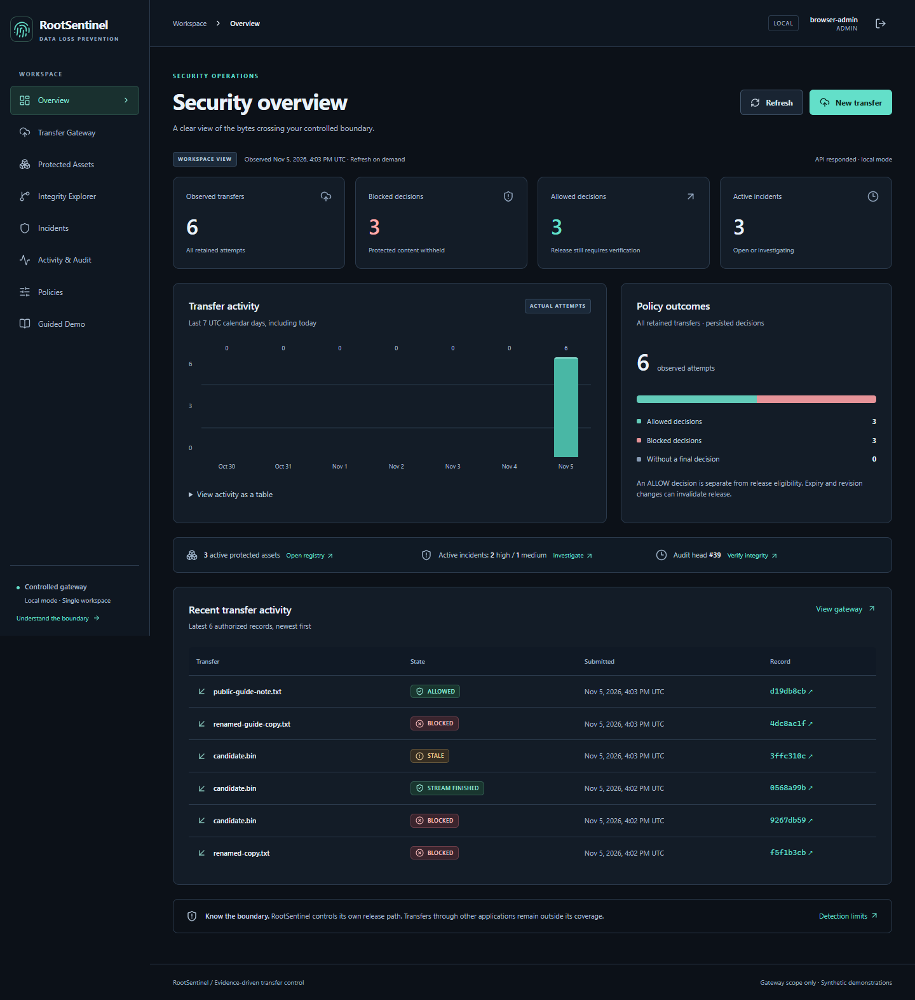
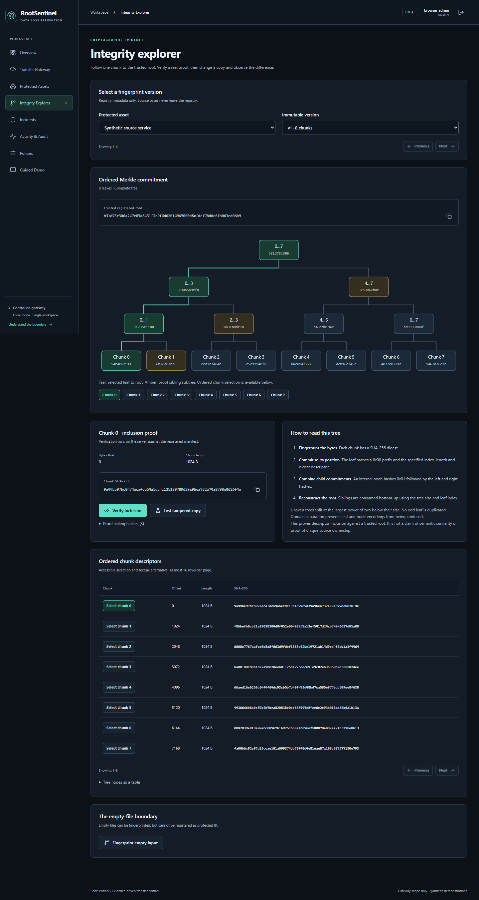
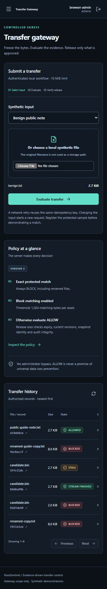

# RootSentinel DLP

**Hash-Based Data Loss Prevention and File Integrity Intelligence Platform**

CS-3002 Information Security · Existing repository: [UsmanPrime/rootsentinel-dlp](https://github.com/UsmanPrime/rootsentinel-dlp)

## Current state

Phase 04 adds a complete role-aware browser workspace around the authenticated
registry, versioned policies, controlled single-use transfer gateway, incident
investigation and HMAC audit integrity. It includes a real interactive Merkle
explorer, exact dashboard aggregates and a guided synthetic demonstration.
**Local browser workflow is implemented. Public deployment and the Linux staging
adapter remain future work.**

The unchanged cryptographic core uses Python `hashlib`. The backend uses FastAPI,
SQLAlchemy/Alembic and Argon2id. Every operational view displays actual backend results.
A scan ALLOW alone never authorizes delivery; the gateway verifies bytes and current
state again before a single-use download.

## Screenshots

Captured from the real application in Chrome against the ephemeral synthetic test
backend (no mocked verdicts). Full set and viewport checks: `docs/evidence/phase-04/`.







## Intended product

- **P0-A:** public browser workflow with synthetic inputs and actual scan/decision/release processing.
- **P0-B:** Linux/WSL2 staging gateway that withholds blocked files and delivers checked snapshot bytes.
- SHA-256 exact-file identification, 1 KiB block fingerprints and Merkle inclusion proofs.
- Evidence that explains both successful detections and known misses.

Enforcement applies only to the controlled gateway. Fixed blocks can miss shifted,
encoded or transformed content. Merkle integrity does not establish authorization.

## Quick validation

Use Python 3.12 or 3.13. From the repository root:

```sh
cd backend
python -B -m unittest tests.test_crypto tests.test_config -v
cd ..
python -B scripts/fixtures.py
```

For the complete backend suite, install `backend/requirements-dev.lock` into an
isolated environment outside source, then run `python -m pytest` from `backend`.
See [local setup and migration instructions](docs/developer-guide.md#phase-02-local-backend).

With Node 22.12+ (below 25):

```sh
cd frontend
npm ci --ignore-scripts --no-audit --no-fund
npm run typecheck
npm test
npm run build
npm run dev
```

The workbench binds to loopback. It is not a production deployment. Dependencies and
build output are ignored by Git; Git-ignore does not exclude OneDrive syncing.

## Documentation

- [Master-plan implementation baseline](docs/master-plan.md)
- [Instructor requirements and traceability](docs/requirements.md)
- [Cryptographic specification](docs/cryptographic-spec.md)
- [Architecture and threat model](docs/architecture.md)
- [Developer installation and storage boundaries](docs/developer-guide.md)
- [Testing and evidence](docs/testing.md)
- [Research references](docs/research.md)
- [Phase 01 completion report](docs/evidence/phase-01.md)
- [Phase 02 completion report](docs/evidence/phase-02.md)
- [REST contract and OpenAPI](docs/api.md)
- [Detection limitations](docs/detection-spec.md)
- [Database and migrations](docs/database.md)
- [Authentication and authorization](docs/authentication.md)
- [Frontend architecture, design system and guided demonstration](docs/frontend.md)
- [Phase 04 verification evidence](docs/evidence/phase-04.md)

## Repository status and contributions

Phase 01 was published at `5d6df58a6118a79e8c6b3928a4225c3aebef6b15`.
Phase 02 preserves that history. Its completion evidence records validation and
publication status; Git history identifies the exact implementation checkpoint.

The course requires exactly three students. Named ownership and actual contribution
history must be recorded by the team; neither is fabricated here. Licensing remains
unselected pending the team's choice; no open-source license is implied.

Never commit original instructor DOCX files, real protected payloads, secrets,
runtime databases, or screenshots containing sensitive machine paths.

## Phase 03 ? controlled transfer and evidence

Local authenticated transfers now retain bounded private snapshots, evaluate the existing
fingerprint/policy engine and release only single-use verified bytes. Protected-content
blocks create investigable incidents. HMAC event chains and independent checkpoints support
explicitly bounded tamper detection. The browser calls real APIs for download, investigation,
export and verification. No operating-system-wide interception or public deployment is claimed.

Start with [local setup](docs/deployment.md), [transfer protocol](docs/transfer-spec.md),
[audit protocol and keys](docs/audit-spec.md), and [Phase 03 verification](docs/evidence/phase-03.md).
