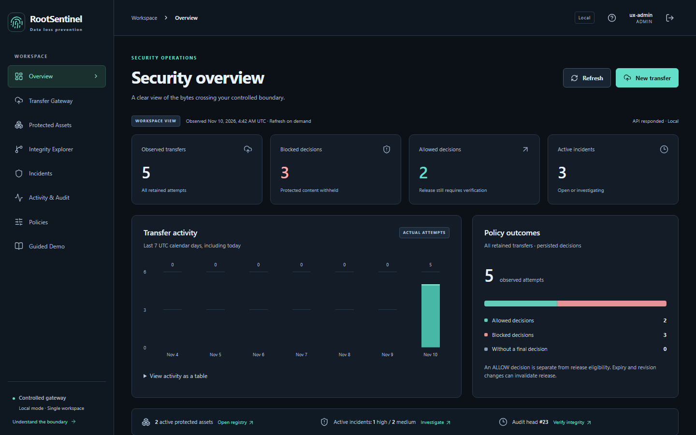
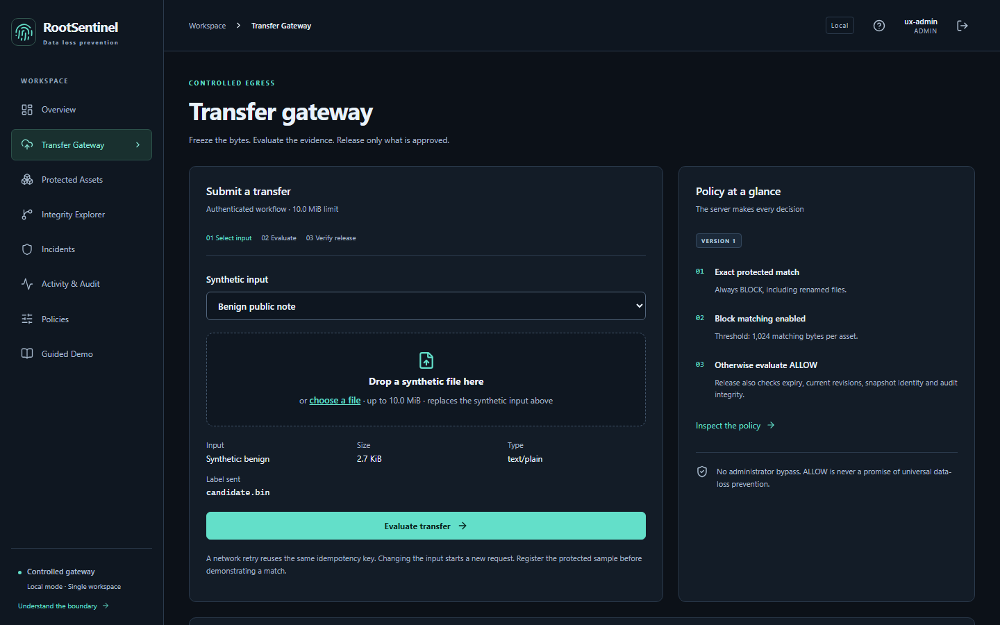
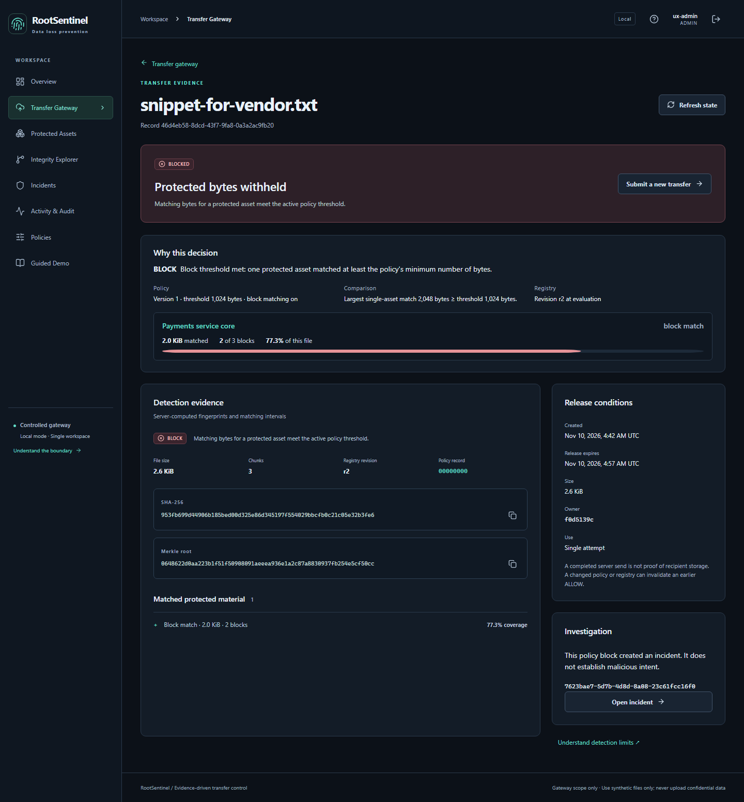
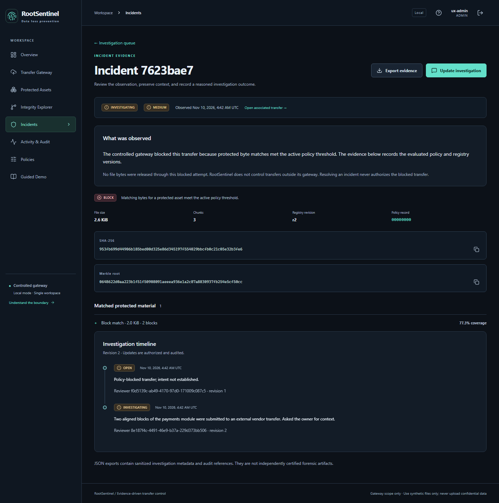
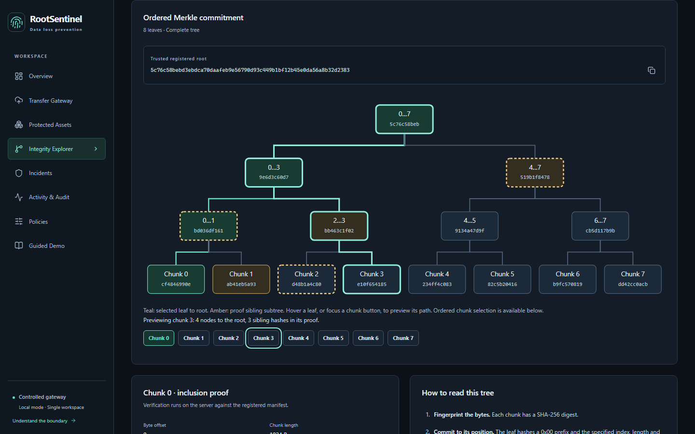
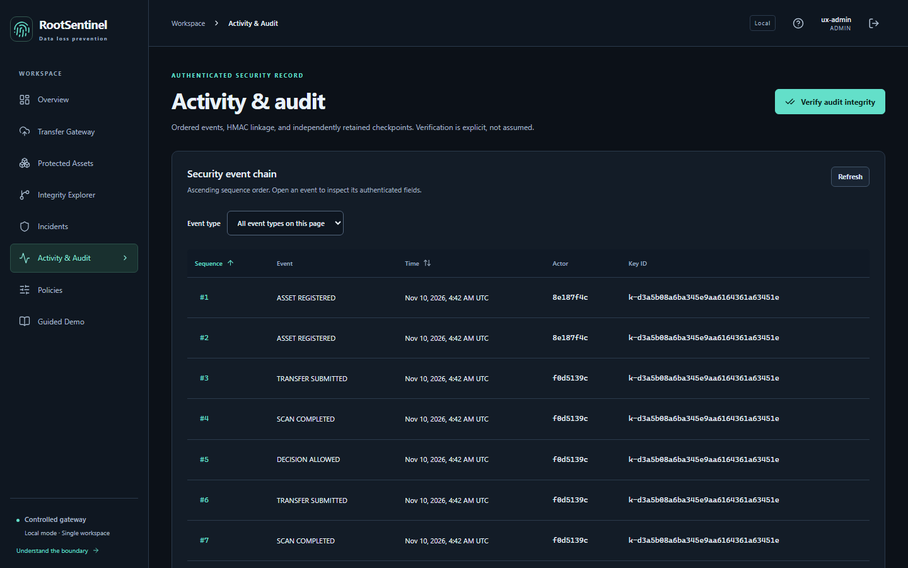
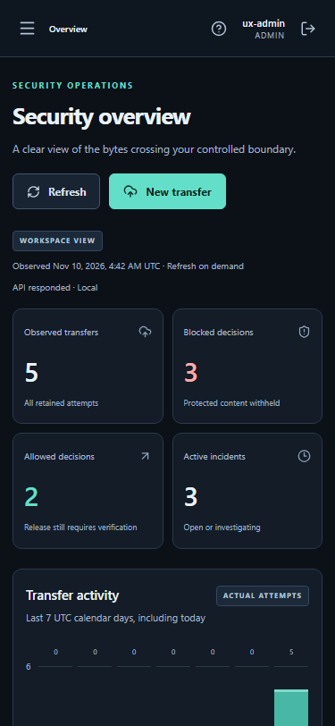
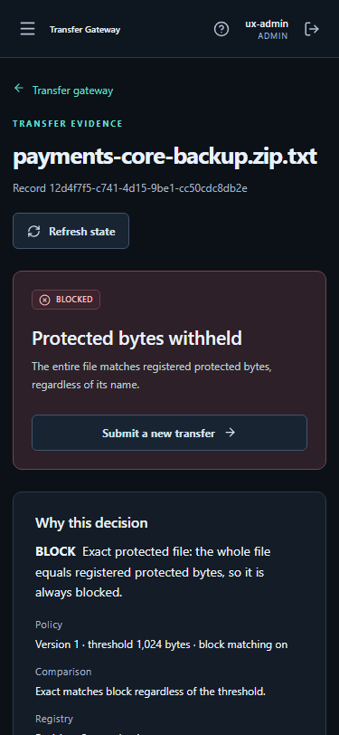
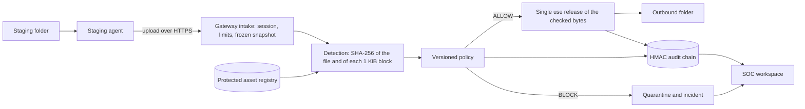
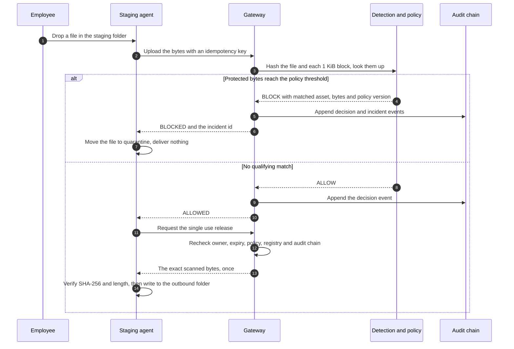

# RootSentinel DLP

Hash-based data loss prevention: a gateway that stops protected source code from leaving through a controlled transfer path.

[](https://github.com/UsmanPrime/rootsentinel-dlp/actions/workflows/ci.yml)
[](https://rootsentinel-dlp.onrender.com)
[](backend/requirements.lock)
[](frontend/package.json)



**Live demo:** https://rootsentinel-dlp.onrender.com. Access is for presenters only: every account is created by the team, and
there is no visitor sign-up. The first load after idle takes about a minute on the free tier (measured; see the verification
evidence linked under [Documentation](#documentation)).

## What it does

An employee who wants to send a file out drops it into a staging folder. A small agent on their machine picks the file up
and sends it to the RootSentinel gateway. The gateway hashes the whole file with SHA-256 and every 1 KiB block of it, then
looks those hashes up in a registry of protected corporate code. If enough protected bytes match, the verdict is BLOCK: the
agent moves the file to quarantine and the gateway opens an incident for an analyst. If nothing protected matches, the verdict
is ALLOW, and the gateway releases the exact bytes it checked, once, to the employee's outbound folder.

## Screenshots

| | |
|---|---|
|  |  |
| Submit a file by drag and drop; the details and the label sent are shown before evaluation. | Every verdict explains itself: the matched asset, bytes, blocks, share of the file and the policy threshold. |
|  |  |
| Each BLOCK opens an incident with its evidence and an audited investigation timeline. | The Merkle explorer previews a block's proof path on hover or keyboard focus. |
|  |   |
| The audit page verifies the HMAC chain and retains checkpoints. | The workspace works down to phone width. |

## How it works



One blocked and one allowed transfer, from the agent's side:



The browser workspace calls the same gateway, so an analyst can also submit synthetic test files, inspect evidence and release
allowed files without the agent.

## Features

* **Exact and partial matching.** The gateway hashes the whole file and each fixed 1 KiB block with SHA-256 and looks both up
  in an indexed registry. An exact file match always blocks. Otherwise the default policy blocks once 1,024 bytes match any one
  protected asset. See the [detection spec](docs/detection-spec.md).
* **Verdicts that explain themselves.** Each transfer shows the rule that decided it, every matching asset with its matched
  bytes, matched blocks and share of the file, and the policy version and threshold it was judged by.
* **Staging agent.** A standard library Python process watches one folder, uploads each new file and writes to the outbound
  folder only after an ALLOW and a release whose SHA-256 matches its own reading of the file. A journal flushed to disk lets it
  recover after a crash without losing or duplicating a file. It refuses links, junctions, nested folders and special files.
  See the [staging spec](docs/staging-spec.md).
* **Controlled release.** Each ALLOW can be released once, by its owner, after a confirmation. The gateway checks again that the
  policy and registry have not changed, then sends the same buffer it scanned; the browser checks the hash before saving.
* **Incidents.** Every BLOCK opens an incident that shows which blocks matched which asset and how much of the file they
  cover. Analysts filter and sort the queue, add notes, resolve incidents and export them as JSON.
* **Tamper evident audit.** Decisions, releases and incident changes are recorded as events in an HMAC SHA-256 chain, with
  checkpoints stored outside the database. The audit page verifies the chain on demand. See the [audit spec](docs/audit-spec.md).
* **Audit transparency log.** The audit events also form an RFC 9162 Merkle tree whose root the gateway signs with Ed25519 at
  every release. The Integrity page checks the signature, an event's inclusion proof and the log's consistency in the browser,
  and `scripts/witness.py` does the same from outside and verifies exported evidence offline.
* **Merkle explorer.** Each registered asset version has a Merkle tree over its blocks. The integrity page draws the tree,
  previews a block's proof path, and verifies inclusion proofs for original and tampered blocks.
* **Role based workspace.** A React interface for three roles: ADMIN manages protected assets and policies, ANALYST
  investigates, EMPLOYEE submits and releases their own transfers. A short tour, which can be skipped and replayed, shows
  where everything lives.
* **Hosted demo.** One Docker image serves the API and the built frontend from the same origin on Render, with PostgreSQL on
  Neon. See [deployment](docs/deployment.md).

## Security design

These rules hold locally and on the hosted demo, and tests cover each one.

* **An ALLOW is not a release credential.** Release is a separate request. The gateway checks the session, the owner, the
  snapshot, and the current policy and registry versions again before it sends a byte.
* **Release is single use.** A second release of the same transfer is refused, even when a dozen requests race.
* **A BLOCK never delivers.** Neither do stale, expired or failed transfers. The response carries no file content.
* **The audit fails closed.** A missing key, a broken chain, a failed checkpoint or a tree head that cannot be signed and
  verified stops the release.
* **Admins have no bypass.** There is no override, and closing an incident does not release the file.
* **Sessions.** Passwords are hashed with Argon2id. Sessions are random tokens in HttpOnly, SameSite=Strict cookies, marked
  Secure over HTTPS. Every change also needs a CSRF token and the exact Origin. Roles and ownership are checked on the server
  for every request; a test walks every route with every role. The interface only hides controls.
* **Content Security Policy.** Every response carries an enforced policy: scripts, styles, images and requests come from the
  same origin only, with no inline code. The browser tests fail on any violation.
* **Login throttling.** Each user name gets 5 attempts a minute, each client 15, and everyone together 30. On the hosted demo
  the client is the address that Cloudflare writes into `True-Client-IP`, so a forged header cannot choose its own bucket.
  This was tested live from two networks.

The full threat model, including what is out of scope, is in [docs/threat-model.md](docs/threat-model.md).

## Run it locally

Windows PowerShell, from the repository root. You need Python 3.12 or 3.13 and Node 22.12 or later (below 25).

Backend and its tests:

```powershell
py -3.13 -m venv "$env:LOCALAPPDATA\RootSentinel\venvs\backend"
$py = "$env:LOCALAPPDATA\RootSentinel\venvs\backend\Scripts\python.exe"
& $py -m pip install -r backend\requirements-dev.lock
Push-Location backend; & $py -m pytest; Pop-Location
```

End to end demo of the staging agent. It starts a throwaway gateway with generated keys and accounts, runs the agent against
synthetic files, checks every outcome and deletes everything afterwards:

```powershell
& $py -B scripts\demo_agent.py
Push-Location agent; & $py -m pytest -p no:cacheprovider; Pop-Location
```

Frontend checks and production build:

```powershell
Push-Location frontend
npm ci --ignore-scripts --no-audit --no-fund
npm run typecheck
npm run format:check
npm test
npm run build
Pop-Location
```

To use the full workspace in a browser against your own local gateway, follow [docs/deployment.md](docs/deployment.md). It
needs an audit key and an admin account, whose password you type at a hidden prompt. Keep runtime data outside the repository
and outside OneDrive; the [developer guide](docs/developer-guide.md) explains why. If pytest reports "Access is denied" on a
`pytest-of-<user>` folder in `%TEMP%`, add `--basetemp` with another folder, as the developer guide describes.

## Testing

The tests check the security rules above from both sides: what must work and what must be refused. An authorization matrix
reads every route from the OpenAPI document and calls it as an anonymous visitor, an employee, an analyst and an admin, with
and without the CSRF token, from a foreign Origin and with a foreign Host. Other tests cover replayed, expired and stale
releases, a dozen releases racing for one transfer, tampered audit events and checkpoints, upload size boundaries, refused
file names and content types, links and special files in the staging folder, and crashes at every agent step. The known
detection misses (shifted, re-encoded and compressed copies) are tests that assert the miss.

A local Windows run gave:

| Suite | Result |
|---|---|
| Backend (`pytest`) | 523 passed, 1 skipped (symbolic links need a privilege the account lacks); 93% branch coverage |
| Staging agent (`pytest`) | 104 passed, 3 skipped (Linux only cases); 86% branch coverage |
| Agent end to end demo | 13 of 13 checks passed |
| Frontend (`vitest`) | 37 tests in 5 files passed; type check and format check clean |
| Browser suite (Playwright, real API, enforced CSP) | 32 journey checks and 8 failure path checks passed; axe found no violation on 17 pages; no page overflows at 320 to 1920 px |
| Accessibility audit | axe found no violation in 96 page and width checks; Lighthouse accessibility and best practices 100 on 8 main routes |

GitHub Actions runs 9 jobs on every push, and all 9 must pass before `main` can change:

| Job | What it runs |
|---|---|
| `backend (3.12)`, `backend (3.13)` | Backend tests on SQLite, fixture checks, API contract drift check |
| `postgres` | Backend tests against a PostgreSQL 17 service |
| `browser` | Builds the interface, serves it from the API with the enforced CSP, and runs the real browser and adversarial suites |
| `frontend` | Type check, format check, unit tests, production build |
| `agent (3.12)`, `agent (3.13)` | Agent unit, fault injection, crash recovery and real gateway tests on Linux, the end to end demo, and a publication audit for secrets and private paths |
| `agent-windows` | Agent tests and the end to end demo on Windows |
| `container` | Builds the Docker image, checks its size budget, that it refuses to start without an https origin and runs unprivileged, then runs the smoke test (including the deployed commit) before and after a restart |

Dependency, secret and configuration scanners (bandit, semgrep, pip-audit, npm audit, gitleaks, trivy, hadolint, actionlint,
zizmor) were run for the verification evidence; [docs/testing.md](docs/testing.md) lists them.

## Limitations

* **Only the gateway and the staging folder are covered.** USB drives, email, the clipboard, cloud sync and other applications
  are not monitored. A file copied anywhere other than the staging folder is not seen.
* **Fixed blocks miss shifted or re-encoded copies.** A one byte insertion at the start, CRLF or UTF-16 conversion,
  compression or base64 can change every block hash. The tests assert these misses. Content defined chunking, which would
  catch shifted copies, is planned.
* **One worker.** Rate limits, processing slots and audit ordering assume a single process.
* **Free tier hosting.** The service sleeps when idle, so the first request waits for a cold start. File checkpoints live on the
  container's disk and are lost on every restart. Signed tree heads are in the database and survive, but a rollback that removes
  them too is noticed only by someone who kept an earlier head: the browser tab or the witness script.
* **The signing key is on the host.** Whoever holds it can sign any tree head. The log shows that recorded events were not
  changed later; it does not show that every action was recorded.
* **Shared networks share a limit.** A classroom behind one NAT shares one client bucket of 15 sign-ins a minute.

## Tech stack

| Area | Technology |
|---|---|
| Backend | Python 3.12 and 3.13, FastAPI, Pydantic, SQLAlchemy, Alembic, Uvicorn |
| Security | `hashlib` SHA-256, HMAC SHA-256 audit chain, Ed25519 signed tree heads (`cryptography`), Argon2id (`argon2-cffi`), enforced CSP |
| Database | SQLite locally, PostgreSQL (Neon) when hosted, via `psycopg` |
| Frontend | React 19, React Router, TypeScript, Vite, Lucide icons |
| Frontend tests | Vitest, Testing Library, jsdom, axe-core, Playwright (browser suite), Prettier |
| Staging agent | Python standard library only |
| Delivery | Docker, Render (free tier), GitHub Actions |

Exact versions are pinned in `backend/requirements.lock`, `backend/requirements-dev.lock` and `frontend/package-lock.json`.
The Python lock files carry SHA-256 hashes for every package, so an install refuses a changed or unlisted file.

## Project structure

```text
rootsentinel-dlp/
  agent/          staging agent
    rootsentinel_agent/
    tests/
  backend/        gateway API
    app/
    migrations/
    tests/
  docker/         container entrypoint
  docs/           specifications, screenshots and verification evidence
    evidence/
    screenshots/
  fixtures/       synthetic test fixture manifests
  frontend/       React workspace
    public/
    src/
  scripts/        demos, smoke test, browser checks, publication audit
  Dockerfile
  render.yaml
```

## Documentation

| Document | Contents |
|---|---|
| [Architecture](docs/architecture.md) | Components, trust boundaries, detection and policy contract |
| [Threat model](docs/threat-model.md) | Abuse cases, controls, tests and residual risk |
| [Cryptographic spec](docs/cryptographic-spec.md) | Hash profile, block layout, Merkle trees |
| [Detection spec](docs/detection-spec.md) | Matching rules and the misses we test for |
| [Policy spec](docs/policy-spec.md) | Versioned policies and thresholds |
| [Transfer spec](docs/transfer-spec.md) | Snapshot, release and transfer states |
| [Audit spec](docs/audit-spec.md) | HMAC chain, keys, checkpoints and the transparency log |
| [Staging spec](docs/staging-spec.md) | Agent behaviour, provisioning and crash recovery |
| [Authentication](docs/authentication.md) | Sessions, roles, CSRF and throttling |
| [API](docs/api.md) | REST contract ([OpenAPI](docs/openapi.json)) |
| [Database](docs/database.md) | Schema and migrations |
| [Frontend](docs/frontend.md) | Routes, design tokens, interaction and the guided demo |
| [Deployment](docs/deployment.md) | Local operation and the hosted demo |
| [Demo runbook](docs/demo-runbook.md) | Keep-alive, budget checks and fallbacks for the grading window |
| [Developer guide](docs/developer-guide.md) | Toolchain, storage rules, repository rules |
| [Testing](docs/testing.md) | Test levels, CI jobs and scanners |
| [Requirements](docs/requirements.md) | Course requirements and traceability |
| [Research](docs/research.md) | References |
| [Verification evidence](docs/evidence/README.md) | Measured results, test and scanner records |

## Team

Usman Ibrahim, Alishba Inam and Amna Zainab.

CS-3002 Information Security, FAST NUCES Islamabad, Topic 3. Individual contributions are documented in the final report.

## License

No license has been chosen yet; all rights reserved.
