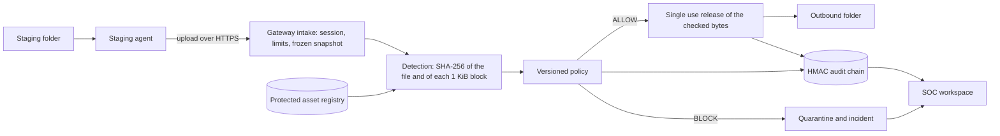

# RootSentinel DLP

Hash-based data loss prevention: a gateway that stops protected source code from leaving through a controlled transfer path.

[](https://github.com/UsmanPrime/rootsentinel-dlp/actions/workflows/ci.yml)
[](https://rootsentinel-dlp.onrender.com)
[](https://github.com/UsmanPrime/rootsentinel-dlp/tags)


**Live demo:** https://rootsentinel-dlp.onrender.com. Access is for presenters only: every account is created by the team, and
there is no visitor sign-up. The first load after idle takes about a minute on the free tier
([measured](docs/evidence/phase-06a.md#cold-start)).

## What it does

An employee who wants to send a file out drops it into a staging folder. A small agent on their machine picks the file up
and sends it to the RootSentinel gateway. The gateway hashes the whole file with SHA-256 and every 1 KiB block of it, then
looks those hashes up in a registry of protected corporate code. If enough protected bytes match, the verdict is BLOCK: the
agent moves the file to quarantine and the gateway opens an incident for an analyst. If nothing protected matches, the verdict
is ALLOW, and the gateway releases the exact bytes it checked, once, to the employee's outbound folder.

## How it works



The browser workspace calls the same gateway, so an analyst can also submit synthetic test files, inspect evidence and release
allowed files without the agent.

## Features

* **Exact and partial matching.** The gateway hashes the whole file and each fixed 1 KiB block with SHA-256 and looks both up
  in an indexed registry. An exact file match always blocks. Otherwise the default policy blocks once 1,024 bytes match any one
  protected asset. See the [detection spec](docs/detection-spec.md).
* **Staging agent.** A standard library Python process watches one folder, uploads each new file and writes to the outbound
  folder only after an ALLOW and a release whose SHA-256 matches its own reading of the file. A journal flushed to disk lets it
  recover after a crash without losing or duplicating a file. It refuses links, junctions, nested folders and special files.
  See the [staging spec](docs/staging-spec.md).
* **Controlled release.** Each ALLOW can be released once, by its owner. The gateway checks again that the policy and registry
  have not changed, then sends the same buffer it scanned.
* **Incidents.** Every BLOCK opens an incident that shows which blocks matched which asset and how much of the file they
  cover. Analysts investigate it, add notes, resolve it and export it as JSON.
* **Tamper evident audit.** Decisions, releases and incident changes are recorded as events in an HMAC SHA-256 chain, with
  checkpoints stored outside the database. The audit page verifies the chain on demand. See the [audit spec](docs/audit-spec.md).
* **Merkle explorer.** Each registered asset version has a Merkle tree over its blocks. The integrity page draws the tree and
  verifies inclusion proofs for original and tampered blocks.
* **Role based workspace.** A React interface for three roles: ADMIN manages protected assets and policies, ANALYST
  investigates, EMPLOYEE submits and releases their own transfers. Policies are versioned, never edited in place.
* **Hosted demo.** One Docker image serves the API and the built frontend from the same origin on Render, with PostgreSQL on
  Neon. See [deployment](docs/deployment.md).

## Security design

These rules hold locally and on the hosted demo, and tests cover each one.

* **An ALLOW is not a release credential.** Release is a separate request. The gateway checks the session, the owner, the
  snapshot, and the current policy and registry versions again before it sends a byte.
* **Release is single use.** A second release of the same transfer is refused.
* **A BLOCK never delivers.** Neither do stale, expired or failed transfers. The response carries no file content.
* **The audit fails closed.** A missing key, a broken chain or a failed checkpoint stops the release.
* **Admins have no bypass.** There is no override, and closing an incident does not release the file.
* **Sessions.** Passwords are hashed with Argon2id. Sessions are random tokens in HttpOnly, SameSite=Strict cookies, marked
  Secure over HTTPS. Every change also needs a CSRF token and the exact Origin. Roles and ownership are checked on the server for every request;
  the interface only hides controls.
* **Login throttling.** Each user name gets 5 attempts a minute, each client 15, and everyone together 30. On the hosted demo
  the client is the address that Cloudflare writes into `True-Client-IP`, so a forged header cannot choose its own bucket.
  This was [tested live with two networks](docs/evidence/phase-06a.md#client-identification-for-the-login-limiter).

The full threat model, including what is out of scope, is in [docs/threat-model.md](docs/threat-model.md).

## Run it locally

Windows PowerShell, from the repository root. You need Python 3.12 or 3.13 and Node 22.12 or later (below 25).

Backend and its tests:

```powershell
py -3.13 -m venv "$env:LOCALAPPDATA\RootSentinel\venvs\backend"
$py = "$env:LOCALAPPDATA\RootSentinel\venvs\backend\Scripts\python.exe"
& $py -m pip install -r backend\requirements-dev.lock
Push-Location backend; & $py -m pytest; Pop-Location
```

End to end demo of the staging agent. It starts a throwaway gateway with generated keys and accounts, runs the agent against
synthetic files, checks every outcome and deletes everything afterwards:

```powershell
& $py -B scripts\demo_phase05.py
Push-Location agent; & $py -m pytest -p no:cacheprovider; Pop-Location
```

Frontend tests and production build:

```powershell
Push-Location frontend
npm ci --ignore-scripts --no-audit --no-fund
npm test
npm run build
Pop-Location
```

To use the full workspace in a browser against your own local gateway, follow [docs/deployment.md](docs/deployment.md). It
needs an audit key and an admin account, whose password you type at a hidden prompt. Keep runtime data outside the repository
and outside OneDrive; the [developer guide](docs/developer-guide.md) explains why.

## Testing

The tests check the security rules above from both sides: what must work and what must be refused. They cover forged
release requests, replayed and stale releases, tampered audit events and proofs, forged headers, other users' records,
oversized and malformed input, links and special files in the staging folder, and crashes at every agent step. The known
detection misses (shifted, re-encoded and compressed copies) are tests that assert the miss.

A local Windows run of the commands above gave:

| Suite | Result |
|---|---|
| Backend (`pytest`) | 311 passed, 1 skipped (symbolic links need a privilege the account lacks) |
| Staging agent (`pytest`) | 96 passed, 3 skipped (Linux only cases) |
| Agent end to end demo | 13 of 13 checks passed |
| Frontend (`vitest`) | 19 tests in 4 files passed |

GitHub Actions runs 9 jobs on every push, and all 9 must pass before `main` can change:

| Job | What it runs |
|---|---|
| `backend (3.12)`, `backend (3.13)` | Backend tests on SQLite, fixture checks, API contract drift check |
| `postgres` | Backend tests against a PostgreSQL 17 service |
| `browser` | Real browser and adversarial acceptance tests of the workspace |
| `frontend` | Type check, unit tests, production build |
| `agent (3.12)`, `agent (3.13)` | Agent unit, fault injection, crash recovery and real gateway tests on Linux, the end to end demo, and a publication audit for secrets and private paths |
| `agent-windows` | Agent tests and the end to end demo on Windows |
| `container` | Builds the Docker image, checks its size budget, that it refuses to start without an https origin and runs unprivileged, then runs the smoke test before and after a restart |

## Limitations

* **Only the gateway and the staging folder are covered.** USB drives, email, the clipboard, cloud sync and other applications
  are not monitored. A file copied anywhere other than the staging folder is not seen.
* **Fixed blocks miss shifted or re-encoded copies.** A one byte insertion at the start, CRLF or UTF-16 conversion,
  compression or base64 can change every block hash. The tests assert these misses. They remain until Phase 07.
* **One worker.** Rate limits, processing slots and audit ordering assume a single process.
* **Free tier hosting.** The service sleeps when idle, so the first request waits for a cold start. Audit checkpoints live on
  the container's disk and are lost on every restart, so the hosted audit chain is tamper evident only within one container
  lifetime.

## Tech stack

| Area | Technology |
|---|---|
| Backend | Python 3.12 and 3.13, FastAPI, Pydantic, SQLAlchemy, Alembic, Uvicorn |
| Security | `hashlib` SHA-256, HMAC SHA-256 audit chain, Argon2id (`argon2-cffi`) |
| Database | SQLite locally, PostgreSQL (Neon) when hosted, via `psycopg` |
| Frontend | React 19, React Router, TypeScript, Vite, Lucide icons |
| Frontend tests | Vitest, Testing Library, jsdom, axe-core |
| Staging agent | Python standard library only |
| Delivery | Docker, Render (free tier), GitHub Actions |

Exact versions are pinned in `backend/requirements.lock`, `backend/requirements-dev.lock` and `frontend/package-lock.json`.

## Project structure

```text
rootsentinel-dlp/
  agent/          staging agent
    rootsentinel_agent/
    tests/
  backend/        gateway API
    app/
    migrations/
    tests/
  docker/         container entrypoint
  docs/           specifications and evidence
    evidence/
  fixtures/       synthetic test fixture manifests
  frontend/       React workspace
    public/
    src/
  scripts/        demos, smoke test, browser checks, publication audit
  Dockerfile
  render.yaml
```

## Documentation

| Document | Contents |
|---|---|
| [Architecture](docs/architecture.md) | Components, trust boundaries, detection and policy contract |
| [Threat model](docs/threat-model.md) | Abuse cases, controls, tests and residual risk |
| [Cryptographic spec](docs/cryptographic-spec.md) | Hash profile, block layout, Merkle trees |
| [Detection spec](docs/detection-spec.md) | Matching rules and the misses we test for |
| [Policy spec](docs/policy-spec.md) | Versioned policies and thresholds |
| [Transfer spec](docs/transfer-spec.md) | Snapshot, release and transfer states |
| [Audit spec](docs/audit-spec.md) | HMAC chain, keys and checkpoints |
| [Staging spec](docs/staging-spec.md) | Agent behaviour, provisioning and crash recovery |
| [Authentication](docs/authentication.md) | Sessions, roles, CSRF and throttling |
| [API](docs/api.md) | REST contract ([OpenAPI](docs/openapi.json)) |
| [Database](docs/database.md) | Schema and migrations |
| [Frontend](docs/frontend.md) | Routes, components and the guided demo |
| [Deployment](docs/deployment.md) | Local operation and the hosted demo |
| [Developer guide](docs/developer-guide.md) | Toolchain, storage rules, repository rules |
| [Testing](docs/testing.md) | Test strategy |
| [Requirements](docs/requirements.md) | Course requirements and traceability |
| [Master plan](docs/master-plan.md) | Phase plan |
| [Research](docs/research.md) | References |
| [Evidence](docs/evidence/README.md) | Verification record for every phase |

## Team

Usman Ibrahim, Alishba Inam and Amna Zainab.

CS-3002 Information Security, FAST NUCES Islamabad, Topic 3. Individual contributions are documented in the final report.

## License

No license has been chosen yet; all rights reserved.
