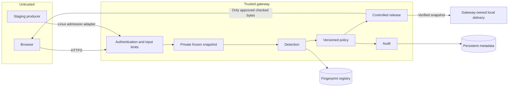
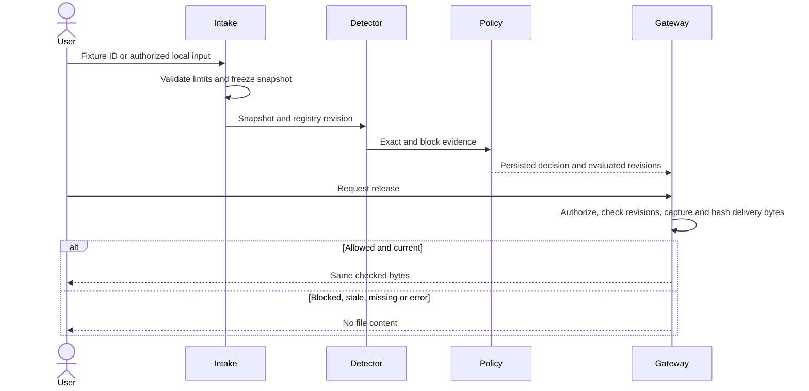

# Architecture and threat model

## Implementation status

Phase 03 adds retained private snapshots, single-use verified downloads, incident
investigation, HMAC audit events and external checkpoints to the existing Phase 02
registry/detection/policy/authentication services. Phase 05 adds the local staging agent,
a separate client of that gateway ([staging-spec](staging-spec.md)); public deployment in
the intended product diagram remains planned. Implemented contracts: [transfers](transfer-spec.md),
[audit protocol](audit-spec.md), [local operation](deployment.md).
See [threat model](threat-model.md), [database](database.md), [detection](detection-spec.md),
[policy](policy-spec.md), [authentication](authentication.md) and [API](api.md).

## Intended architecture

React/TypeScript/Vite frontend; FastAPI/Pydantic modular backend; SQLite locally,
PostgreSQL for hosting. One origin, one application worker, bounded concurrency.
No Redis, Celery, microservices, arbitrary forwarding URLs or kernel agents.
Tailwind is the application-phase styling target; the foundation shell uses small
CSS token/component files and currently has no Tailwind dependency.





Plaintext exists in browser/server memory and snapshots. HTTPS encrypts public
transport to the TLS terminator; the database connection also uses TLS. Digests
are not encryption. Providers/host administrators can access server-side plaintext.
No application encryption-at-rest or enterprise compliance claim is made.

## Detection and policy contract

Register immutable versions. Exact digest match always blocks. Otherwise default
policy blocks at 1024 matched outbound bytes for any one protected asset. Count
each outbound interval once per asset, report shared attribution and repetition,
and record profile/registry/policy versions. Coverage is explanatory, not the sole
blocking threshold. Empty protected-asset registration is rejected.

Authentication, invalid input, stale state and infrastructure errors prevent release.
No administrator override exists in P0. Policy changes create new versions; changed
policy or registry revisions require rescan before release. Incident closure does
not grant permission. Public visitors are currently denied API access. Synthetic-only public isolation is a later release gate.

## Trust and residual risks

Trusted: backend, host OS, deployment administrators, authorized registry baseline.
Untrusted: browser input, filenames, staging producers, proof packages. Database
tamper tests assume the attacker does not also possess audit integrity keys.

| Threat | Planned mitigation | Residual risk |
|---|---|---|
| Exact protected copy | SHA-256 match and withheld release | Other transfer channels remain available |
| Edits/partial copying | Fixed block matching | Shifts, tiny snippets and transformations can evade |
| Shared boilerplate | Per-asset evidence and threshold | Policy false positives remain possible |
| Object-ID guessing | Server-side ownership/role checks | Authorized analysts can inspect evidence |
| Malicious paths | Generated snapshot IDs; agent admission is no-follow (descriptor-relative on POSIX, `lstat` plus identity checks on Windows) | Host compromise excluded; Windows keeps a small check-to-use window |
| Source mutation | Scan frozen snapshot; release same checked buffer | Original producer state may be unstable |
| Resource exhaustion | 10 MiB local/1 MiB public limits; two processing slots | Distributed DoS outside project guarantee |
| Proof substitution | Independently trusted expected manifest | Registry authority compromise defeats trust |
| Audit edits | HMAC-SHA-256 chain and external checkpoints | Key compromise; uncheckpointed tail truncation |
| Logs expose source/secrets | Allowlisted metadata and redaction tests | Infrastructure logs need separate review |

## Secrets lifecycle

SHA-256 has no key. Session tokens are 32 random bytes from `secrets`; persist token
digests, rotate on login/privilege changes, revoke on logout/reset/admin action.
Cookies are HttpOnly/Secure in deployment, SameSite=Strict with CSRF/Origin validation.
Use Argon2id for passwords. Audit keys are independent random 32-byte values stored
outside Git and the database. Records carry key IDs; retain old keys for verification,
rotate after disclosure, and mark compromised epochs untrusted. TLS lifecycle is
delegated to the provider. Phase 02 implements sessions, Argon2id, CSRF, password
reset and session revocation. Phase 03 implements audit key provisioning, HMAC records and independent checkpoints.

## Phase 02 module boundaries

`settings` validates configuration; `db` owns engines/units of work; `models` maps
persistence; `schemas` allowlists input/output. `registry`, `detection`, `policy`
and `scans` contain domain behavior. `auth` owns session checks; `intake` owns
temporary copy/freeze/cleanup. `api` integrates them. Phase 01 `crypto` is unchanged.

```mermaid
sequenceDiagram
  actor User
  participant API
  participant Intake
  participant Scan
  participant DB
  User->>API: Authenticated raw synthetic bytes + CSRF
  API->>API: Validate Origin, role, size/capacity
  API->>Intake: Stream to private temporary handle
  Intake-->>API: Frozen bytes + random ID; close temporary file
  API->>Scan: Actor, display name, frozen input
  Scan->>Scan: SHA-256, fixed chunks, Merkle commitment
  Scan->>DB: Begin transaction and lock registry state
  DB-->>Scan: Stable revision and policy version
  Scan->>DB: Indexed exact and batched chunk queries
  Scan->>Scan: Group evidence and evaluate policy
  Scan->>DB: Persist evaluation, matches and decision; commit
  Scan-->>API: Evidence and decision, release_authorized=false
  API-->>User: Typed JSON
```

The [SQLAlchemy transaction model](https://docs.sqlalchemy.org/en/20/orm/session_transaction.html)
and [Alembic migration workflow](https://alembic.sqlalchemy.org/en/latest/tutorial.html)
were inspected during implementation. Sessions are not shared across requests.

## Implemented Phase 03 orchestration

`api.py` installs `gateway_api.py` with the existing principal and bounded intake dependencies.
`transfers.Gateway` consumes `scans.run_scan`, whose detector/policy implementations are unchanged.
`snapshots` and `private_files` own retained payloads; `windows_acl` performs read-only DACL checks.
`incidents` owns investigation and export; `audit` owns canonical HMAC verification and checkpoints.
`gateway_models` supplies six new relational tables; migration 0002 preserves migration 0001.

```mermaid
sequenceDiagram
  participant Browser
  participant Gateway
  participant RegistryLock as Registry/Policy lock
  participant Snapshot as Private snapshot
  participant Audit as HMAC stream
  participant Checkpoint as Independent checkpoint
  Browser->>Gateway: POST transfer + session/CSRF/idempotency UUID
  Gateway->>Snapshot: Freeze bounded bytes under generated ID
  Gateway->>RegistryLock: Lock; run existing scan/policy
  Gateway->>Audit: Commit decision and incident if BLOCK
  Gateway-->>Browser: Evidence and state
  Browser->>Gateway: POST release
  Gateway->>RegistryLock: Lock; current revisions and ownership
  Gateway->>Audit: Verify chain, head and checkpoint
  Gateway->>Snapshot: Capture immutable bytes, verify digest/length
  Gateway->>Audit: Commit single-use RELEASE_STARTED
  Gateway->>Checkpoint: Persist committed audit head
  Gateway-->>Browser: Same verified buffer only
  Gateway->>Audit: STREAM_FINISHED or DELIVERY_UNKNOWN
```

## Phase 04 presentation boundary

The React workspace uses the existing authenticated APIs and adds only two read-only
presentation endpoints: role-scoped SQL overview aggregates and bounded Merkle tree
projections computed by the existing core. No schema or transfer enforcement changes.
See [frontend architecture](frontend.md) for routes, request cancellation, session
isolation and the browser-side supplementary download digest check.
