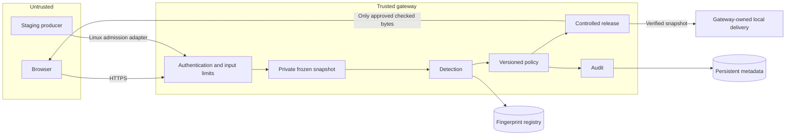
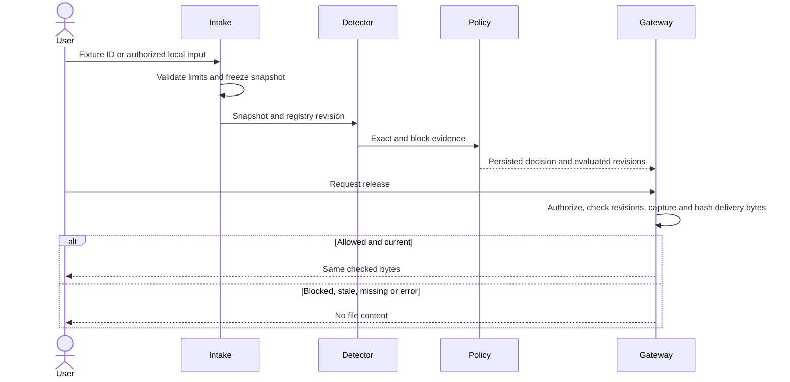

# Architecture and threat model

## Implementation status

Phase 01 implements cryptographic primitives/composition and path configuration.
All operational components below are planned, not working security controls yet.

## Intended architecture

React/TypeScript/Vite frontend; FastAPI/Pydantic modular backend; SQLite locally,
PostgreSQL for hosting. One origin, one application worker, bounded concurrency.
No Redis, Celery, microservices, arbitrary forwarding URLs or kernel agents.
Tailwind is the application-phase styling target; the foundation shell uses small
CSS token/component files and currently has no Tailwind dependency.

Plaintext exists in browser/server memory and snapshots. HTTPS encrypts public
transport to the TLS terminator; the database connection also uses TLS. Digests
are not encryption. Providers/host administrators can access server-side plaintext.
No application encryption-at-rest or enterprise compliance claim is made.

## Detection and policy contract for the next phases

Register immutable versions. Exact digest match always blocks. Otherwise default
policy blocks at 1024 matched outbound bytes for any one protected asset. Count
each outbound interval once per asset, report shared attribution and repetition,
and record profile/registry/policy versions. Coverage is explanatory, not the sole
blocking threshold. Empty protected-asset registration is rejected.

Authentication, invalid input, stale state and infrastructure errors prevent release.
No administrator override exists in P0. Policy changes create new versions; changed
policy or registry revisions require rescan before release. Incident closure does
not grant permission. Public visitors can select only server-owned synthetic files.

## Trust and residual risks

Trusted: backend, host OS, deployment administrators, authorized registry baseline.
Untrusted: browser input, filenames, staging producers, proof packages. Database
tamper tests assume the attacker does not also possess audit integrity keys.

| Threat | Planned mitigation | Residual risk |
|---|---|---|
| Exact protected copy | SHA-256 match and withheld release | Other transfer channels remain available |
| Edits/partial copying | Fixed block matching | Shifts, tiny snippets and transformations can evade |
| Shared boilerplate | Per-asset evidence and threshold | Policy false positives remain possible |
| Object-ID guessing | Server-side ownership/role checks | Authorized analysts can inspect evidence |
| Malicious paths | Generated snapshot IDs; descriptor-relative local access | Host compromise excluded |
| Source mutation | Scan frozen snapshot; release same checked buffer | Original producer state may be unstable |
| Resource exhaustion | 10 MiB local/1 MiB public limits; two processing slots | Distributed DoS outside project guarantee |
| Proof substitution | Independently trusted expected manifest | Registry authority compromise defeats trust |
| Audit edits | HMAC-SHA-256 chain and external checkpoints | Key compromise; uncheckpointed tail truncation |
| Logs expose source/secrets | Allowlisted metadata and redaction tests | Infrastructure logs need separate review |

## Secrets (planned)

SHA-256 has no key. Session tokens are 32 random bytes from `secrets`; persist token
digests, rotate on login/privilege changes, revoke on logout/reset/admin action.
Cookies are HttpOnly/Secure in deployment, SameSite=Lax with CSRF/Origin validation.
Use Argon2id for passwords. Audit keys are independent random 32-byte values stored
outside Git and the database. Records carry key IDs; retain old keys for verification,
rotate after disclosure, and mark compromised epochs untrusted. TLS lifecycle is
delegated to the provider. No such secrets are generated in Phase 01.
