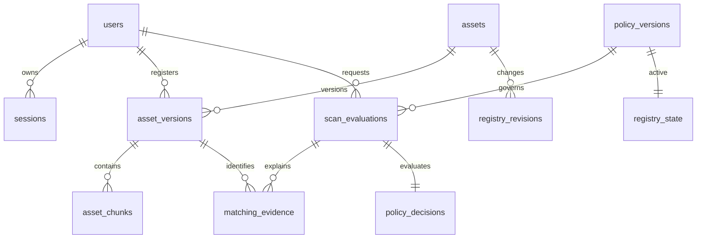

# Database schema and migrations

SQLAlchemy 2.0 maps eleven application tables; Alembic adds its version table.
Identifiers are UUID strings except the singleton registry state's fixed key.
UTC timestamps are timezone-aware in Python/PostgreSQL; SQLite stores UTC values
and the type adapter restores timezone information on reads.

| Table | Purpose / constraints |
|---|---|
| users | Unique username, Argon2id hash, checked role, enabled state |
| sessions | Unique token digest, CSRF digest, user FK, expiry and revocation |
| assets | Unique label, current version number, retirement flag |
| asset_versions | Immutable manifest fields; unique asset/version and asset/content; actor and revision FKs |
| asset_chunks | Version/index composite primary key, bounded index/length, digest index |
| registry_revisions | Append-only number, asset, actor, action and timestamp |
| registry_state | Singleton revision counter and active policy FK |
| policy_versions | Immutable sequence and validated threshold |
| scan_evaluations | Actor, candidate manifest, snapshot identity, registry revision and policy FK |
| matching_evidence | One row per scan/version, grouped references and exact rational coverage in JSON |
| policy_decisions | One immutable decision per scan, reason and sorted qualifying versions |

Migration `0001` contains explicit table/index creation and seed state; application
startup never calls `create_all`. Database triggers reject UPDATE and DELETE on
versions, chunks, revisions, scans, matching evidence and decisions. These protect
application history from accidental changes, not from a database owner who can drop
triggers or alter storage. Scan revision zero represents the initial empty registry;
it is a scalar revision snapshot rather than an FK to a synthetic actor/event row.

Registry/policy mutations and scans first issue a no-op UPDATE against the singleton
state. SQLite takes its writer lock; PostgreSQL takes a row lock. All relevant writes
use this protocol, so active versions and policy stay stable throughout detection
and persistence. Each unit of work owns its SQLAlchemy session and transaction.
An exception rolls back the whole operation, including revision increments.

SQLite has a 15-second busy timeout and foreign-key enforcement on every connection.
The current design serializes evaluation transactions and registry writes; it favors
correctness and bounded local demos over high throughput. Two HTTP intake/processing
slots bound simultaneous payload work. Read-only metadata uses independent sessions.

## Reproduction

After configuring external storage and installing the locked dependencies, run from
`backend`: `python -m alembic upgrade head`, then `python -m alembic current`.
Repeated upgrade is safe. Back up existing metadata and review migration SQL before
future upgrades. Do not use `downgrade base` on a working registry: it removes data.
Automated tests exercise downgrade/re-upgrade only on disposable test databases.

PostgreSQL uses `postgresql+psycopg`. Deployment must use a privately supplied URL,
verified TLS, a restricted runtime role, and a separate migration role. CI's trust
authentication is solely for its disposable service and is not a deployment recipe.
When `ROOTSENTINEL_TEST_POSTGRES_URL` is supplied, the test fixture creates a fresh
random `rs_test_...` schema per test and drops only that schema afterward. Use a
dedicated test database and role with schema-creation permissions. The same tests
run on SQLite and PostgreSQL; without that variable only SQLite executes. See the
Phase 02 evidence for what was actually run. SQL compilation alone is not parity.

## Migration 0002 ? controlled transfer evidence

Adds `transfers`, `release_attempts`, `incidents`, `incident_history`, `audit_heads`,
`audit_events`. Snapshot identity/digest/length/expiry live on transfers; payload bytes live
only in private temporary storage. No redundant snapshot table is needed. Unique actor +
idempotency key, snapshot ID, transfer scan ID, single release attempt per transfer,
incident per transfer, history revision and audit sequence constrain contradictory records.
Foreign keys bind actors/scans/transfers and stream heads. Indexed actor/state/expiry and
incident status support bounded queries. UTC conversion is shared with Phase 02.

An initial random stream UUID is seeded once. Immutable triggers cover audit_events and
incident_history in both SQLite and PostgreSQL. Existing Phase 02 immutability triggers
remain. State transitions are enforced by the orchestration service; DB administrators
are not assumed constrained by application triggers. Independent HMAC verification catches
covered evidence modification. Checkpoints are retained independently, not merely copied
into the same database. Migration tests include clean schema, downgrade/re-upgrade on
isolated data and preservation of Phase 02 asset fingerprints during upgrade.
