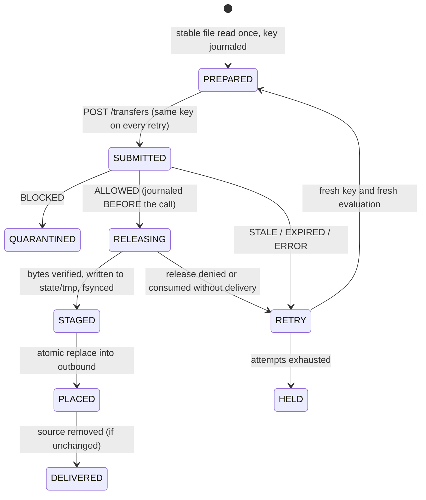

# Staging gateway agent — specification (Phase 05)

Topic Guide requirement (T P15): *a local file gateway script monitoring an employee's staging
directory, hashing outbound files against a blacklist of corporate intellectual property hashes to
instantly block unauthorized transfers.* This document defines what was built, exactly where its
enforcement stops, and how it recovers from failure. "Instantly block" keeps the meaning recorded in
[requirements](requirements.md): **no file is delivered before a persisted ALLOW**, not zero latency.

## What it is, and the enforcement boundary

`agent/rootsentinel_agent` is a separate, standard-library-only process. It is a **client** of the existing
REST gateway ([API](api.md), [transfer protocol](transfer-spec.md)). The server stays the only decision
maker: the agent holds no hash registry, makes no allow/deny decision and changes none of the gateway's
cryptography, detection, policy, release or audit logic (`backend/app`, migrations, OpenAPI and the
frontend are byte-identical to the Phase 04 head; see `scripts/verify_phase05.py`).

The agent controls **only what reaches its outbound directory**. A file is placed there only after
(1) the gateway persisted ALLOW, (2) the single-use release returned bytes, and (3) those bytes matched
the SHA-256 computed locally from the one read of the source. Everything else delivers nothing.

**What is NOT covered.** The agent does not monitor or block: USB or removable media, e-mail, cloud sync
clients, browsers, clipboard, screenshots, printing, network transfers, other applications, or a user
copying a file directly to wherever the outbound directory's consumer reads. It is not operating-system
interception, not a kernel driver, and not protection against a compromised host, a compromised agent
account or key, or an administrator. A directory watcher alone cannot prevent exfiltration; the
protection exists only where the organisation makes the agent's outbound directory the *only* way out.

Content limits are those of fixed 1 KiB block matching ([detection](detection-spec.md)): shifted, re-encoded
(CRLF, UTF-16), compressed or archived copies and copies below the policy threshold are **known misses**.
The tests assert these misses explicitly so they cannot be hidden. Files over 10 MiB are never scanned
and therefore never delivered. Files in subdirectories are not scanned (nonrecursive).

On Windows, separating *who may write* staging from *who may write* outbound is an **operator step** (a
second account and ACLs). On a one-person machine the employee and the agent are the same user, so the
separation cannot be demonstrated there; it is demonstrated on Linux CI with a second user id
(`test_a_second_uid_can_fill_staging_but_cannot_write_outbound_while_the_agent_delivers`).

## Directories

All four must be absolute, outside the repository and OneDrive, free of symbolic-link / junction /
reparse components, distinct and non-nested, and on **one volume** (so renames are atomic).

| Directory | Purpose | Notes |
|---|---|---|
| `staging` | where the employee drops files | the only untrusted input |
| `outbound` | verified deliveries only | POSIX: must not be group/other writable |
| `quarantine` | `<entry>.held` (blocked file) and `<entry>.report.json` | POSIX 0700 |
| `state` | `journal.jsonl`, `lock`, `tmp/` (in-flight writes) | POSIX 0700; temp files live here, never in outbound |

## Admission (what may be read, and when)

Only direct children of `staging` are considered; a dropped folder is reported and never scanned.
Each entry is classified with `lstat`; these are rejected, left in place, journaled once and never submitted:

| Reason | Meaning |
|---|---|
| `LINK_OR_REPARSE_POINT` | symbolic link, Windows junction or other reparse point |
| `DIRECTORY_NOT_SCANNED` | a directory (nonrecursive) |
| `SPECIAL_FILE` | FIFO, socket, device |
| `HARDLINK` | link count other than 1 |
| `EMPTY_FILE` | zero bytes (visible reason, held; an empty file cannot be a protected asset) |
| `TOO_LARGE` | over 10 MiB (the gateway's limit) |
| `IDENTITY_UNAVAILABLE` | the platform returned no file identity (fail closed) |

Ordinary files are admitted by **stability polling**: the same (device, inode, size, mtime) on
`stable_polls`=2 consecutive polls and unmodified for `settle`=2 s. Stability cannot distinguish a *paused*
writer from a finished one; worst case a partial file is delivered and the completed file later delivered
as a separate entry. It is not a bypass (each delivered byte sequence was scanned whole). A producer that
writes then **renames to `*.ready`** gives a reliable signal: such files are admitted on first sight (the
read still re-verifies identity), and the suffix is removed from the label and delivered name.
`--require-ready` admits only `*.ready` files and ignores everything else.

The read is performed once: `lstat`, open without following links, `fstat` (same identity, one link, regular),
read exactly `size` bytes, `fstat` again, `lstat` again; any difference raises `Unstable`, the file is looked
at again later. The bytes sent are the bytes hashed. The source is removed only if it is still the exact file
that was scanned; an edit made meanwhile is kept and processed as a new file.

### Platform differences (verified, not assumed)

* **POSIX:** descriptor-relative access (`dir_fd`) with `O_NOFOLLOW`, as promised in the
  [developer guide](developer-guide.md#staging-agent-phase-05). A symlink swapped in after observation is not followed.
* **Windows:** there is no `dir_fd`; the agent uses `lstat`, the reparse-point attribute, link counts and the
  post-open identity comparison. A small time-of-check/time-of-use window remains against a hostile writer who
  can replace operator-owned parent directories; that is outside the threat model ([threat model](threat-model.md)).
* **Windows file identity was measured on Windows 11 / Python 3.13.4 / NTFS:** `os.lstat` returns non-zero,
  distinct `(st_dev, st_ino)` that are stable across rename and equal to the `fstat` of an opened handle;
  hardlinks show `st_nlink == 2` with the same inode; junctions carry the reparse bit (`0x400`). Because
  `DirEntry.stat()` from `scandir` returns `st_ino == 0` on Windows, the agent calls `os.lstat` per entry and
  rejects any entry whose inode is 0 (`IDENTITY_UNAVAILABLE`, fail closed). Python 3.12 on Windows has not been
  verified locally.
* Windows exposes no directory `fsync`; durability of a rename across power loss is not claimed, which is why
  recovery re-verifies facts on disk instead of trusting the journal.

## Delivery pipeline



1. Journal `PREPARED` (key, label, chosen outbound name, source identity, SHA-256, size) with fsync, **before** any network byte.
2. `POST /api/v1/transfers`. A network-level retry **reuses the same Idempotency-Key**; the gateway then returns the existing
   transfer (this prevents orphan ALLOWED transfers that would exhaust the 10-per-account pending cap for 15 minutes).
   The response digest and size must equal the local ones, otherwise the file is held and **not released**.
3. `BLOCKED` → move the source to `quarantine/<entry>.held`, write the payload-free report. Nothing is released.
4. `ALLOWED` → journal `RELEASING` (the single use may now be consumed) then `POST …/release`.
5. Verify length and SHA-256 against the local digest; write `state/tmp/<entry>.<attempt>.part`, fsync, re-read, verify; journal `STAGED`.
6. `os.replace` into `outbound` (a name collision gets an entry suffix; an existing different file is never overwritten); journal `PLACED`.
7. Remove the source if unchanged; journal `DELIVERED`.

A new evaluation (new key) is created only after a terminal outcome: STALE, EXPIRED, ERROR, DELIVERY_UNKNOWN, a denied or
consumed release, or a byte mismatch. At most 5 attempts per file (backoff 2 s doubling to 120 s, up to 25 % jitter), then
`HELD`: the file stays in staging, nothing is delivered, and `status` / `requeue` show and retry it.

## Journal

`state/journal.jsonl`, append-only, one JSON object per line, fsynced before the action it announces. Fields:
`v, seq, t, entry, ev, crc` plus event fields from an allowlist (`key, label, out, orig, src, sha256, size, attempt,
transfer, tstate, expires, incident, reason, not_before, tmp, rk, report`); any other field name is refused, so the
journal cannot hold payload bytes, passwords, cookies or CSRF tokens. `crc` is a CRC-32 of the record: it detects a
**torn final write** (discarded with a warning; the previous state stands). A damaged record in the middle stops the
agent (fail closed). The CRC is not tamper evidence; the state directory is operator-trusted. The journal contains
original file names; keep the directory private.

## Crash recovery

On start the agent removes `state/tmp` files not referenced by a `STAGED` entry, then resumes every non-terminal entry,
verifying facts on disk and with the gateway rather than trusting the journal alone.

| Last durable event | What recovery finds | Action |
|---|---|---|
| none / torn `PREPARED` | no server contact has happened | file is admitted again as new |
| `PREPARED` | source may or may not have been sent | re-read the source; identity or digest changed → `ABANDONED` (changed file rescanned as new); else submit with the **same key** (existing transfer returned or a new one created) |
| `SUBMITTED`, BLOCKED | file in staging or already moved | finish the idempotent move and report → `QUARANTINED` |
| `SUBMITTED`, ALLOWED | GET shows ALLOWED and unexpired | `RELEASING` |
| `SUBMITTED`, other | EXPIRED, STALE, ERROR, SCANNING | `RETRY` (SCANNING waits) |
| `RELEASING` | GET shows ALLOWED (call never reached the gateway) | release again |
| `RELEASING` | RELEASE_STARTED, STREAM_FINISHED, DELIVERY_UNKNOWN, STALE, EXPIRED | the single use is consumed and the bytes are gone; the source is still in staging → `RETRY` with a new key. The spent release stays visible in the audit trail |
| `STAGED` | temp file present and digest matches | atomic replace → `PLACED` (**no second release**) |
| `STAGED` | temp file gone, outbound has the same digest | `PLACED` (crash between replace and journal) |
| `STAGED` | both missing or invalid | treated as consumed → `RETRY` |
| `PLACED` | outbound file matches | remove the source if unchanged → `DELIVERED` |
| `PLACED` | outbound file missing or different (e.g. power loss) | treated as consumed → `RETRY` |
| `DELIVERED` | source still present (removal failed) | removal retried, bounded; never resubmitted |
| `HELD`, `REJECTED` | any | skipped until the source changes or `requeue` |
| gateway restarted | SCANNING→ERROR, RELEASE_STARTED→DELIVERY_UNKNOWN | handled by the GET rows above |
| state directory lost | no memory of earlier work | staged files are resubmitted with fresh keys; orphan ALLOWED transfers may occupy pending capacity for up to 15 minutes; a duplicate outbound copy under a suffixed name is possible |

## Gateway protocol (what the client must do, and does)

* Gateway in `local` mode (everything under `/api/v1` is closed in `public_demo`). The public browser workflow does not
  depend on the agent and nothing in `backend/app` or `frontend/src` references it (checked by `verify_phase05.py`).
* `Host` must be the gateway's permitted loopback host; mutating calls carry `Origin` equal to the gateway's configured
  origin and `X-CSRF-Token`. Plaintext HTTP is accepted only to loopback; any other host needs HTTPS.
* The session cookie `rs_session` is Secure, HttpOnly and SameSite=Strict, so the agent reads it from `Set-Cookie` and
  attaches it manually (no cookie jar). Backend settings are not loosened for the agent. The session lasts 3600 s; a 401
  triggers one re-login (never faster than every 15 s; the gateway allows 5 logins per minute per account).
* `Content-Type: application/octet-stream` exactly; a UUID Idempotency-Key; the filename label must match
  `^[A-Za-z0-9][A-Za-z0-9 ._()-]*$` (1–120). The agent's sanitizer maps any name to a valid label (also safe as a Windows
  file name) and never uses the label as a path on the server.
* The agent account must be `EMPLOYEE` (least privilege); it aborts at startup otherwise. Release is owner-only, so the same
  account submits and releases.
* Self-imposed budget of 20 counted calls per minute (submit and release share the gateway's 30 per account). 429 → wait
  15 s then 60 s; capacity 503 → wait a few seconds; both leave the file untouched. 403 and a rejected login are fatal
  (retrying cannot help). Three consecutive audit/checkpoint failures at release stop the agent (fail closed).

## Credentials

Only a private JSON file (`{"username","password"}`) or a hidden prompt. There is no password option and no environment
variable; command-line abbreviations are disabled so `--pass` cannot be mistaken for one. The password is never logged,
journaled, reported or put in an exception message.

**Windows limitation (stated plainly):** the agent does **not** verify the DACL of the credentials file on Windows and the
file is **not claimed to be ACL protected**. It enforces: absolute path, outside the repository and OneDrive, no link or
reparse component, a regular single-link file under 4 KiB with exactly the two keys, and exclusive creation. The file takes
the ACL of the directory it is created in; keep it in a directory only your account can read. On POSIX the agent also
requires mode `0600` and refuses anything else. The backend's DACL inspector is deliberately not duplicated here.

## Quarantine report

`<entry>.report.json` contains only: entry id, sanitized label, size, SHA-256, transfer id and state, decision outcome and
reason, incident id (the EMPLOYEE cannot read incident severity; analysts see HIGH for exact matches and MEDIUM for
threshold matches), number of matching versions, exact-match flag, best coverage numbers, whether the file was held, and
a timestamp. No payload, no path, no original file name field, no asset identifiers.

## Commands

`python -B -m rootsentinel_agent <command>` from the `agent` directory (or with `agent` on `PYTHONPATH`):

| Command | Purpose |
|---|---|
| `init --root R` | create and validate `staging/ outbound/ quarantine/ state/` |
| `init-credentials --file F --username U` | create the 0600 credentials file from a hidden prompt (never overwrites) |
| `check …` | validate directories, gateway `/health` (local mode, release configured), login and EMPLOYEE role |
| `run … [--once] [--require-ready]` | run; `--once` exits 0 when every file is settled, 3 if it gave up waiting |
| `status --root R` | journal summary and the reason for every held or rejected file |
| `requeue --root R --all-held` | give held files a fresh set of attempts |

`python -B -m rootsentinel_agent.register …` is the separate **ADMIN** tool that registers a folder of synthetic files as
protected assets, one request per file, serially (no bulk import exists; every registration bumps the registry revision and
turns in-flight ALLOWED transfers STALE, so register first). Its password comes only from a hidden prompt.

## Provisioning (exact commands; run by the operator)

The automated tests and `scripts/demo_phase05.py` use a disposable gateway with a temporary runtime and generated
credentials. They create nothing persistent. The commands below create a persistent local setup; run them yourself.
Use an existing Python 3.12/3.13 environment that already has `backend/requirements-dev.lock` installed.

```powershell
# every terminal; <repository root> is your checkout
Set-Location '<repository root>'
$py = '<path to python.exe of that environment>'
$P5 = Join-Path $env:LOCALAPPDATA 'RootSentinel\phase05'

# gateway environment (terminal A and for the CLI commands). Secure cookies stay at their default.
$env:ROOTSENTINEL_MODE            = 'local'
$env:ROOTSENTINEL_ORIGIN          = 'http://127.0.0.1:5173'
$env:ROOTSENTINEL_RUNTIME_ROOT    = "$P5\runtime"
$env:ROOTSENTINEL_ARTIFACT_ROOT   = "$P5\artifacts"
$env:ROOTSENTINEL_AUDIT_KEY_FILE  = "$P5\audit-secrets\audit-keys.json"
$env:ROOTSENTINEL_CHECKPOINT_ROOT = "$P5\trusted-checkpoints"

# one-time gateway setup (working directory: backend)
Set-Location backend
& $py -m alembic upgrade head
& $py -m app.audit_keys init $env:ROOTSENTINEL_AUDIT_KEY_FILE
& $py -m app.cli create-user rs-admin    --role ADMIN        # hidden password prompts
& $py -m app.cli create-user rs-employee --role EMPLOYEE
& $py -m app.cli create-user rs-analyst  --role ANALYST

# start the gateway (terminal A, working directory: backend, ONE worker)
& $py -m uvicorn app.api:create_app --factory --host 127.0.0.1 --port 8000 --workers 1 --no-access-log --no-proxy-headers
Invoke-RestMethod http://127.0.0.1:8000/health      # expect mode=local, release_configured=True

# agent setup and run (terminal B, working directory: agent)
Set-Location '<repository root>\agent'
& $py -B -m rootsentinel_agent init --root "$P5\agent"
& $py -B -m rootsentinel_agent init-credentials --file "$P5\agent-secrets\agent-credentials.json" --username rs-employee
& $py -B ..\scripts\source_corpus.py --out "$P5\corpus"
& $py -B -m rootsentinel_agent.register --base-url http://127.0.0.1:8000 --origin http://127.0.0.1:5173 --username rs-admin --folder "$P5\corpus\protected"
$agent = @('--root', "$P5\agent", '--base-url', 'http://127.0.0.1:8000', '--origin', 'http://127.0.0.1:5173', '--credentials-file', "$P5\agent-secrets\agent-credentials.json")
& $py -B -m rootsentinel_agent check @agent
& $py -B -m rootsentinel_agent run @agent

# optional: the browser console for the analyst (terminal C, working directory: frontend)
Set-Location '<repository root>\frontend'; $env:ROOTSENTINEL_API_PORT = '8000'; npm run dev -- --port 5173 --strictPort
```

Then copy files from `$P5\corpus\...` (or edited copies of them) into `$P5\agent\staging` and watch `outbound`,
`quarantine` and the analyst's Incidents page. The runtime, key, checkpoint and credentials directories are created by the
application and the commands above on first use. If the browser console does not accept the Secure cookie on loopback in
your browser, the existing documented loopback-only setting `ROOTSENTINEL_SECURE_COOKIES=false`
([developer guide](developer-guide.md)) may be used for the gateway; the agent works with either.

Optional hardening (a **system change that needs a second local Windows account, which this project does not create**):
`icacls "$P5\agent\outbound" /inheritance:r /grant:r "<agent-account>:(OI)(CI)F" "<employee-account>:(OI)(CI)R"` and
`icacls "$P5\agent\staging" /grant "<employee-account>:(OI)(CI)M"`, with the agent running as `<agent-account>`.

On Linux the same flags apply; keep the directories on the distribution's native filesystem (never `/mnt/c`, `/mnt/e` or
OneDrive), mode 0700 except `staging` (employee-writable) and `outbound` (readable by others, writable only by the agent).

## Verification evidence and criteria

See [Phase 05 evidence](evidence/phase-05.md) for results. Criteria and the tests that prove them
(`agent/tests`, run with `python -m pytest` from `agent`):

| # | Criterion | Tests |
|---|---|---|
| 1 | benign delivered byte-identical, staging emptied | `test_c1_…`, `test_happy_path_…` |
| 2 | renamed protected copy quarantined, HIGH incident, audit verifies | `test_c2_…` |
| 3 | partial follows policy; shifted/CRLF/UTF-16/zip documented as misses | `test_c3_…` (7 cases) |
| 4 | growing file not submitted until stable | `test_c4_…` |
| 5 | link, hardlink, directory, empty, special, oversized rejected | `test_c5_…`, `test_fsutil_cli.py` |
| 6 | backend down, 401, 403, 429, 503, timeout deliver nothing; no duplicates | `test_pipeline_faults.py`, `test_c6_…` |
| 7 | crash after release before write neither loses nor silently duplicates | `test_c7_…` (6 crash points) |
| 8 | STALE after registry or policy change delivers nothing; resubmit rescans | `test_c8_…` |
| 9 | kill during the outbound write leaves no partial visible file | `test_c9_…` |
| 10 | no credentials in logs, journal, reports or Git | `test_no_credentials_…`, `test_cli_has_no_password_option_…`, publication audit |
| 11 | CI job runs the agent against a real gateway | `agent` and `agent-windows` jobs in `.github/workflows/ci.yml` |
| 12 | existing tests, crypto and migrations unaffected | `scripts/verify_phase05.py` boundary diffs |
| 13 | reproducible demo, spec, threat model, evidence | `scripts/demo_phase05.py`, this document |

## Known limitations

Enforcement covers only the controlled outbound directory (see above). Fixed-block matching misses transformed
content. Stability polling cannot tell a paused writer from a finished one. One agent per state directory (an instance lock
enforces it) and one gateway worker. Delivery to outbound is not proof that a recipient received or kept the file. The
journal and quarantine hold original content and file names and must stay private. `scripts/verify_phase05.py` leaves its
temporary directory in the system temp folder (delete it manually). Hosted Linux, Python 3.12, PostgreSQL and hosted
Windows results exist only after a candidate push (see the evidence file).
