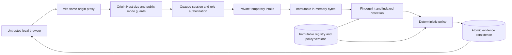

# Implemented threat model — Phase 02

The system evaluates local synthetic uploads. No file transfer enforcement is
implemented. The original product context and future trust-boundary diagram remain
in [architecture](architecture.md); this document specifies today's controls.

Trusted: backend process, OS, private runtime-directory owner, database operator,
authorized asset baseline and administrator. Untrusted: browser parameters, filenames,
payload bytes, cookie/proof submissions and other authenticated users. A compromised
host/database administrator is outside the protection boundary. No cross-tenant
isolation claim is made; the deployment is a single workspace.

| Abuse | Implemented control / test | Residual limitation |
|---|---|---|
| Session guessing or credential reuse | Random token, digest storage, Argon2id, expiry/revocation and bounded attempts | Restart resets throttling; no MFA |
| CSRF and hostile origin | Origin, Host, SameSite and CSRF checks | XSS or host compromise can act as user |
| Employee reads other scans/registry | Role plus ownership checks; cross-user tests | Own evidence reveals equality with protected material |
| Client chooses hashes | Hash server-received bytes; no registration hash input | Authorized malicious baseline remains possible |
| Traversal/filename injection | Strict display labels, generated tempfile name, no supplied storage paths | Not a hostile local filesystem admission adapter |
| Mutable upload source | One streamed temporary copy becomes immutable bytes; original never reread | Client can upload arbitrary bytes; no producer authenticity |
| Partial/oversized upload | Count actual bytes, 60-second intake timeout, declared-length consistency, cleanup | Process crash may leave platform-dependent temporary files; no secure erasure claim |
| Memory/query amplification | 10 MiB, two intake slots, batched indexed lookup, evidence caps, bounded pages | Sustained authenticated traffic can exhaust disk metadata; operator quotas/retention later |
| Historical changes | Immutable-version DB triggers and immutable persisted evaluations | DBA can disable triggers; cryptographic audit chain is Phase 03 |
| Concurrent policy/registry edit | Shared state transaction lock and optimistic version preconditions | Serialized writes limit throughput |
| Infrastructure failure | Rollback and INDETERMINATE response, never authorized release | Unavailable DB cannot persist its own failure |
| Logs disclose input | Allowlisted errors, hidden SQL parameters, no body logging; sentinel tests | Operator/infrastructure logs still need review |
| Public upload exposure | Default public-demo mode denies all operational API routes | Public synthetic account workflow is not yet implemented |
| Shifted/encoded/compressed content | Reproducible limitation tests | Fixed chunks do not decode or perform semantic analysis |
| Transfers outside this application | No claim of prevention | All other network/OS exfiltration paths remain possible |

Runtime directories must be external to source and known synchronized storage.
POSIX directory permissions are checked for 0700; Windows relies on the private
user-profile parent ACL, which operators must inspect before using non-synthetic data.
The application rejects configured symlink/junction storage directories, but does
not claim to withstand a local attacker who can replace private parent directories.
Temporary files are closed/unlinked on normal errors, disconnects and cancellation;
their bytes briefly exist in plaintext and are not securely erased from disks/RAM.

SHA-256 is unkeyed. Session tokens rotate at login and can be revoked; password reset
revokes existing sessions. Future audit integrity keys must be independently generated,
stored outside the database/source, rotated with key IDs and externally checkpointed.
No audit-key functionality is falsely represented as working in this phase.
