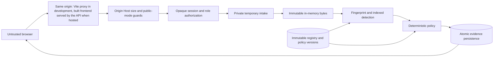

# Implemented threat model

The system evaluates authenticated uploads and enforces bounded single-use
downloads through its controlled gateway, locally and on the hosted demo. The product context and trust-boundary
diagram are in [architecture](architecture.md); this document specifies today's controls.

Trusted: backend process, OS, private runtime-directory owner, database operator,
authorized asset baseline and administrator. Untrusted: browser parameters, filenames,
payload bytes, cookie/proof submissions and other authenticated users. A compromised
host/key holder is outside the protection boundary. Database-only event modification
is checked by the Phase 03 HMAC chain and independent checkpoint. No cross-tenant
isolation claim is made; the deployment is a single workspace.

| Abuse | Implemented control / test | Residual limitation |
|---|---|---|
| Session guessing or credential reuse | Random token, digest storage, Argon2id, expiry/revocation and bounded attempts | Restart resets throttling; no MFA |
| CSRF and hostile origin | Origin, Host, SameSite and CSRF checks | XSS or host compromise can act as user |
| Employee reads other scans/registry | Role plus ownership checks; cross-user tests | Own evidence reveals equality with protected material |
| Client chooses hashes | Hash server-received bytes; no registration hash input | Authorized malicious baseline remains possible |
| Traversal/filename injection | Strict display labels, generated tempfile name, no supplied storage paths | Not a hostile local filesystem admission adapter |
| Mutable upload source | One streamed temporary copy becomes immutable bytes; original never reread | Client can upload arbitrary bytes; no producer authenticity |
| Partial/oversized upload | Count actual bytes against the configurable upload cap, 60-second intake timeout, declared-length consistency, cleanup | Process crash may leave platform-dependent temporary files; no secure erasure claim |
| Memory/query amplification | Upload cap `ROOTSENTINEL_MAX_UPLOAD_BYTES` (default 10 MiB), two intake slots, batched indexed lookup, evidence caps, bounded pages | Sustained authenticated traffic can exhaust disk metadata; operator quotas/retention later |
| Historical changes | Immutable-version DB triggers and immutable persisted evaluations | DBA can disable triggers; HMAC verification detects covered event tampering without keys |
| Concurrent policy/registry edit | Shared state transaction lock and optimistic version preconditions | Serialized writes limit throughput |
| Infrastructure failure | Rollback and INDETERMINATE response, never authorized release | Unavailable DB cannot persist its own failure |
| Logs disclose input | Allowlisted errors, hidden SQL parameters, no body logging; sentinel tests | Operator/infrastructure logs still need review |
| Public upload exposure | Default `public_demo` mode denies all operational API routes; the hosted demo has no anonymous access (operator-provisioned accounts only) | An anonymous visitor mode with synthetic fixtures is an open decision and is not implemented |
| Shifted/encoded/compressed content | Reproducible limitation tests | Fixed chunks do not decode or perform semantic analysis |
| Transfers outside this application | No claim of prevention | All other network/OS exfiltration paths remain possible |

Runtime directories must be external to source and known synchronized storage.
POSIX directory permissions are checked for 0700; Windows relies on the private
user-profile parent ACL, which operators must inspect before using non-synthetic data.
The application rejects configured symlink/junction storage directories, but does
not claim to withstand a local attacker who can replace private parent directories.
Temporary files are closed/unlinked on normal errors, disconnects and cancellation;
their bytes briefly exist in plaintext and are not securely erased from disks/RAM.

SHA-256 is unkeyed. Session tokens rotate at login and can be revoked; password reset
revokes existing sessions. Audit integrity keys are independently generated, stored
outside the database and source, rotated with key IDs and checkpointed externally; see
the [audit specification](audit-spec.md).

## Phase 03 implemented boundary

See [transfer invariant](transfer-spec.md) and [audit trust assumptions](audit-spec.md).
The only payload route is an authenticated owner-only POST release. BLOCK, stale/expired
revisions, missing/altered snapshots, missing keys, failed mandatory audit or checkpoint
operations cannot construct a payload response. Current policy/registry locking is checked
at acquisition, not continuously during network delivery. The immutable buffer defeats
path mutation after capture. No recipient-storage/exactly-once guarantee is claimed.

Windows DACL and POSIX mode checks reject broad storage permissions. The host, application
identity and operator-owned parents remain trusted. HMAC protects canonical event fields
against database-only modification without keys; it does not authenticate every mutable
application table or defeat a compromised key/host. Tail truncation needs an independent
trusted checkpoint. Pre-Phase-03 records have no retroactive HMAC guarantee. Runtime and
checkpoint failures may deny service; safety is prioritized over automatic retries.

Resource limits: upload cap `ROOTSENTINEL_MAX_UPLOAD_BYTES` (default 10 MiB, 1 MiB on the
hosted demo), two processing slots, 20 pending snapshots globally, ten per account,
`ROOTSENTINEL_TRANSFER_RATE_PER_MINUTE` transfer attempts per account per minute (default 30,
10 on the hosted demo) and 120 globally, 20,000 audit events.
Deployment is one worker; restart clears in-memory rate buckets. Analysis notes are
user-entered text: do not paste sensitive source or secrets into them. Export is unsigned
metadata, not independently certified forensic evidence.

## Phase 04 frontend boundary

Route guards and hidden controls do not grant authorization. Every mutation retains
server-side RBAC, ownership, Origin and CSRF checks. The client stores no sessions in
localStorage and clears private views on logout/401. GET requests abort on navigation.
React escapes untrusted text; no raw HTML rendering is used. Downloads use server
generated names and a browser digest/length comparison before Blob saving. This is
additional defense, not a replacement for pre-release server byte verification.
Overview counts and tree views expose only authorized metadata; public mode remains
closed. The API serves the built app from the same origin. Every response carries an
enforced Content-Security-Policy (`default-src 'none'`, `script-src 'self'`, `style-src 'self'`,
no `'unsafe-inline'`), locally and hosted; the interface has no inline scripts or inline
style attributes.

## Phase 05 staging agent boundary

The agent ([staging-spec](staging-spec.md)) is a separate, standard-library client of the controlled gateway. It adds no
release path and no decision logic; it enforces the gateway's outcome on one directory. Trusted: the operator-owned
state/quarantine/outbound directories, the gateway and the host OS. Untrusted: everything an employee can put in the
staging directory (bytes, names, links, timing) and the network path to the gateway.

| Abuse | Implemented control / test | Residual limitation |
|---|---|---|
| Copy a protected file under another name | Server-side exact/block match, quarantine, no release (`test_c2_…`) | Names are never trusted either way |
| Partial copy of protected content | Block threshold applies (`test_c3_…`: two aligned blocks and a single aligned block blocked) | Below-threshold copies are allowed by policy |
| Shifted, CRLF, UTF-16, compressed or archived copy | Not detected; **asserted as known misses** | Fixed 1 KiB blocks cannot see transformed content; no decoding |
| Symlink, junction, hardlink, FIFO or device placed in staging | Classified by `lstat`, rejected and never read (`test_c5_…`, `test_fsutil_cli.py`); symlink swapped after observation is not followed (POSIX `O_NOFOLLOW`) | Windows has no `dir_fd`: a small check-to-use window remains against a hostile writer who can replace operator-owned parents |
| Nested folder to smuggle content | Nonrecursive; nested files are never read and never delivered | They stay in staging unscanned |
| File still being written | Stability polling; `.ready` hint (`test_c4_…`) | A paused writer looks finished; a partial file may be delivered, then the whole file later |
| File edited after it was scanned | Delivered bytes are the released, digest-verified bytes; the source is deleted only if unchanged (`test_file_edited_after_…`) | The edit is processed as a new file |
| Gateway down, throttled, timing out, or answering with errors | Fail closed; same-key replay so no duplicate transfer; bounded backoff (`test_pipeline_faults.py`) | Delivery can be delayed indefinitely |
| Tampered or truncated release body | Length and SHA-256 must equal the local digest; mismatch is never delivered | The single use is spent and a fresh evaluation is needed |
| Crash at any step | fsync'd journal, `RELEASING` journaled before the single-use call, recovery table (`test_c7_…`, `test_c9_…`) | A crash between release and write spends the release; it stays visible in the audit trail |
| Registry or policy changed after ALLOW | Gateway returns STALE; nothing delivered; fresh transfer rescans (`test_c8_…`) | Changes are checked at release, not continuously |
| Credential disclosure | No password option or environment variable; private file or hidden prompt; allowlisted journal fields; no secrets in logs, reports or errors (`test_no_credentials_…`) | **Windows file ACL is not verified by the agent**; path rules only |
| Over-privileged agent account | Aborts unless the account role is EMPLOYEE | A compromised agent account can do what that employee can |
| Producer writes straight to outbound | Operator permission separation | Not enforceable on a one-user Windows machine; shown on hosted Linux CI with a second uid (run 42268818788) |
| Other channels (USB, e-mail, cloud sync, clipboard, other apps, direct copy) | **No claim** | Entirely outside the agent |

The journal and quarantine directories hold original file names and, for blocked files, the blocked content. They are
operator-private and are not secured against a host administrator or the agent's own account. Power loss on Windows is
handled by re-verifying disk state during recovery, not by directory fsync, which Windows does not offer.

## Hosted presenter-demo surface (Phase 06A)

Scope: one free-tier container (the gateway, the built frontend and `bootstrap`) in front of a free PostgreSQL service, reached over
https through the host's reverse proxy. **No anonymous or visitor access exists**; every account is created by the operator.
It is deployed; the measurements are in the [Phase 06A evidence](evidence/phase-06a.md). The staging agent stays local and
independent of this surface.

| Threat | Control (test) | Residual risk |
|---|---|---|
| Unauthenticated use of the API | Every `/api/v1` route except sign-in and the session check answers 401 (the session check answers 204 and reveals nothing); a test iterates all routes and fails if an unexpected route appears (`test_every_anonymous_api_route_is_denied_...`) | Sign-in itself is open to guessing within the existing limits (5 per user, 15 per client and 30 overall per minute) |
| `public_demo` weakened | Unchanged: every API route stays denied (`test_public_demo_still_denies_every_api_route`) | None added |
| Forged `Host` or `Origin` | Exact Host allow-list (origin plus explicit extra hosts, no wildcards) and exact Origin on every non-GET, also for static files (`test_host_and_origin_checks_...`) | A misconfigured origin makes the site return 400 until fixed |
| Spoofed client address evades the per-client login limit | Header mode (`ROOTSENTINEL_CLIENT_IP_HEADER=True-Client-IP` on the hosted demo): the key is the one address in that header; a missing, repeated or invalid value goes to one shared `unidentified` bucket; `X-Forwarded-For` is ignored; startup refuses the header together with nonzero hops (`test_client_ip.py`). Hop-count mode remains available and is tested (`test_login_throttle_keys_on_the_trusted_forwarded_address_...`) | Relies on Cloudflare overwriting `True-Client-IP` in front of Render; re-verify after any edge change. A classroom NAT shares one bucket |
| Path traversal or secret exposure through static files | Only GET and HEAD; the resolved path must stay inside the frontend directory; dot-files and backslashes refused; unknown file-like paths are 404, not HTML (`test_static_serving_cannot_leave_...`) | A symlink test is skipped on Windows (runs on Linux CI) |
| API documentation reveals the surface | Interactive docs and `/openapi.json` are off for hosted and `public_demo`; the schema is public in the repository anyway | None meaningful |
| Transport and browser hardening | Enforced CSP on every response (no `'unsafe-inline'`); HSTS when hosted (no preload, no subdomains); `X-Frame-Options: DENY`; `no-store`; nosniff (`test_hosted.py`; the browser acceptance job fails on any CSP violation) | The CSP does not stop a malicious same-origin script that the build itself contains |
| Secrets in the repository, image or logs | Key file and account hashes arrive as platform secret files; hashes only, never passwords; `bootstrap` and the entrypoint print counts and generic errors; access logging is off; CI uses throwaway secrets (`test_bootstrap_*`, publication audit) | The platform operator and anyone with the dashboard can read the key and the database URL; host compromise is out of scope |
| Privilege on the host | The server runs as uid 10001; root is used only to copy two files (the CI `container` job, a required check, verifies the server uid) | A container escape or a malicious dependency is not addressed |
| Audit stream filled or fail-closed | Hosted per-account transfer limit (10 per minute in `render.yaml`; the code default is 30), 1 MiB upload cap, the smoke test prints the sequence number; the audit still fails closed at 20000 events | Only authenticated accounts can add events, but a leaked class password can still exhaust the stream; recovery means a new database |
| Free-tier restarts and sleep | Restart recovery marks interrupted transfers `ERROR` or `DELIVERY_UNKNOWN`; a vanished snapshot makes release fail closed | In-flight demonstrations can be lost; retained snapshots and checkpoints are not durable |
| Audit rewrite after a restart | The HMAC chain and the key held only by the app host; signed tree heads stored in the database: at startup the tree is rebuilt and must match the latest head, or every audited action is refused (`test_transparency_log.py`) | Truncation or rollback **that also removes the stored heads** is not detected by the gateway itself; it is detected by any party that kept an earlier head outside the database (browser tab, `scripts/witness.py`, an exported bundle). Not forensic evidence. |
| Uploaded content | Authenticated accounts only; 1 MiB on the hosted demo (code default 10 MiB); never executed or decompressed; removed on BLOCK, release or expiry; the interface asks for synthetic data | The reminder is not a control: a user can still upload real data, and chunk hashes and the label persist in the database |
| Supply chain | Locked Python and Node dependencies; every Python pin carries SHA-256 hashes, so pip refuses a changed file or an unlisted package; base images pinned by tag | Hashes are those published by the package index at lock time, not an attestation of the source; no image digests |

Gateway invariants are re-asserted in the hosted configuration (`test_hosted_*`): a scan ALLOW is not a release credential, release
is single use and owner-only, a BLOCK never delivers, and a broken audit chain stops the release.

## Audit transparency log (delta)

What the signed tree heads add to the audit chain, and what they do not. Encodings and key handling are in the
[cryptographic specification](cryptographic-spec.md#audit-transparency-log-tree-and-signed-tree-heads); behaviour is
in the [audit protocol](audit-spec.md#transparency-log-signed-tree-heads-over-the-chain).

| Threat | Control (test) | Residual risk |
|---|---|---|
| Stored events edited, removed or reordered under a signed head | The head's root no longer matches: refused at startup, by full verify, and by any holder of that head (`test_a_stored_event_altered_before_the_last_head_fails_closed_at_restart`, `test_an_edit_under_a_signed_head_is_caught_by_full_verify_and_at_restart`) | Between restarts a release reads again only the events after the latest head; an edit under it is caught at the next restart or full verify, not by that release |
| Events after the latest head edited | Read again and checked before every release (`test_only_the_events_after_the_last_head_are_read_again_at_release`) | None added |
| Database truncated or rolled back | With heads left in place: refused at startup. Under a running process: `AUDIT_LOG_ROLLBACK`. Against a head kept outside the database: the consistency proof fails or the log is smaller (`test_truncating_...`, `test_a_database_rolled_back_under_a_running_process_is_refused`, `test_the_witness_detects_a_rollback_and_keeps_its_saved_head`) | **A party with no earlier head cannot detect a rollback** that also removes the heads; the gateway after a restart is such a party (`test_a_rollback_that_also_removes_the_heads_is_detected_only_with_a_head_kept_outside`) |
| Stored head edited, replaced or forged | Append-only triggers; one head per size; every use verifies the Ed25519 signature and the root (`test_stored_heads_cannot_be_updated_or_deleted`, `test_an_altered_stored_head_fails_closed_at_restart`) | A database owner can drop the triggers and **delete** heads; they cannot forge one without the signing key |
| Forked log (two histories shown to different parties) | One head per size in the database; a witness rejects two roots at one size and any head that does not extend its saved one (`test_a_fork_another_log_and_a_tampered_state_are_rejected`) | Two parties that never compare heads can be shown different logs by whoever holds the signing key |
| Release without a recorded, signed head | Submission and release refuse without the signing key; the release transaction fails unless a head covering `RELEASE_STARTED` is signed and verifies; a failed signing leaves no event and no head (`test_release_is_refused_when_signing_fails_and_nothing_is_left_half_done`) | None added |
| Signing key stolen | Separate private file, permission checks, never printed, never sent to the browser (`test_the_key_route_shows_public_keys_only`, `test_the_tool_creates_a_private_key_file_...`) | The key lives on the application host: host compromise or the hosting dashboard exposes it, and its holder can sign any head. Heads saved by a witness before the theft keep their meaning |
| Export altered after download | The bundle's events, proofs and head are checked offline against a pinned key (`test_an_exported_bundle_verifies_offline_and_every_change_is_caught`) | Only the transparency section is covered; the incident text around it is not signed |
| Proof endpoints used to exhaust the service | Role-gated like the audit events; every parameter bounded; proofs come from memory (`test_every_parameter_is_bounded`) | Each proof request takes the audit head lock briefly |

The log shows that events were recorded and not later changed. It does not show that every action was recorded, and
it says nothing about what happened outside the gateway.
