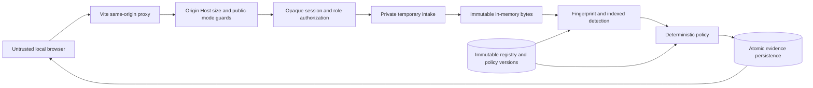

# Implemented threat model — Phase 03

The system evaluates local synthetic uploads and enforces bounded single-use
downloads through its controlled gateway. The original product context and future trust-boundary diagram remain
in [architecture](architecture.md); this document specifies today's controls.

Trusted: backend process, OS, private runtime-directory owner, database operator,
authorized asset baseline and administrator. Untrusted: browser parameters, filenames,
payload bytes, cookie/proof submissions and other authenticated users. A compromised
host/key holder is outside the protection boundary. Database-only event modification
is checked by the Phase 03 HMAC chain and independent checkpoint. No cross-tenant
isolation claim is made; the deployment is a single workspace.

| Abuse | Implemented control / test | Residual limitation |
|---|---|---|
| Session guessing or credential reuse | Random token, digest storage, Argon2id, expiry/revocation and bounded attempts | Restart resets throttling; no MFA |
| CSRF and hostile origin | Origin, Host, SameSite and CSRF checks | XSS or host compromise can act as user |
| Employee reads other scans/registry | Role plus ownership checks; cross-user tests | Own evidence reveals equality with protected material |
| Client chooses hashes | Hash server-received bytes; no registration hash input | Authorized malicious baseline remains possible |
| Traversal/filename injection | Strict display labels, generated tempfile name, no supplied storage paths | Not a hostile local filesystem admission adapter |
| Mutable upload source | One streamed temporary copy becomes immutable bytes; original never reread | Client can upload arbitrary bytes; no producer authenticity |
| Partial/oversized upload | Count actual bytes, 60-second intake timeout, declared-length consistency, cleanup | Process crash may leave platform-dependent temporary files; no secure erasure claim |
| Memory/query amplification | 10 MiB, two intake slots, batched indexed lookup, evidence caps, bounded pages | Sustained authenticated traffic can exhaust disk metadata; operator quotas/retention later |
| Historical changes | Immutable-version DB triggers and immutable persisted evaluations | DBA can disable triggers; HMAC verification detects covered event tampering without keys |
| Concurrent policy/registry edit | Shared state transaction lock and optimistic version preconditions | Serialized writes limit throughput |
| Infrastructure failure | Rollback and INDETERMINATE response, never authorized release | Unavailable DB cannot persist its own failure |
| Logs disclose input | Allowlisted errors, hidden SQL parameters, no body logging; sentinel tests | Operator/infrastructure logs still need review |
| Public upload exposure | Default public-demo mode denies all operational API routes | Public synthetic account workflow is not yet implemented |
| Shifted/encoded/compressed content | Reproducible limitation tests | Fixed chunks do not decode or perform semantic analysis |
| Transfers outside this application | No claim of prevention | All other network/OS exfiltration paths remain possible |

Runtime directories must be external to source and known synchronized storage.
POSIX directory permissions are checked for 0700; Windows relies on the private
user-profile parent ACL, which operators must inspect before using non-synthetic data.
The application rejects configured symlink/junction storage directories, but does
not claim to withstand a local attacker who can replace private parent directories.
Temporary files are closed/unlinked on normal errors, disconnects and cancellation;
their bytes briefly exist in plaintext and are not securely erased from disks/RAM.

SHA-256 is unkeyed. Session tokens rotate at login and can be revoked; password reset
revokes existing sessions. Future audit integrity keys must be independently generated,
stored outside the database/source, rotated with key IDs and externally checkpointed.
No audit-key functionality is falsely represented as working in this phase.

## Phase 03 implemented boundary

See [transfer invariant](transfer-spec.md) and [audit trust assumptions](audit-spec.md).
The only payload route is an authenticated owner-only POST release. BLOCK, stale/expired
revisions, missing/altered snapshots, missing keys, failed mandatory audit or checkpoint
operations cannot construct a payload response. Current policy/registry locking is checked
at acquisition, not continuously during network delivery. The immutable buffer defeats
path mutation after capture. No recipient-storage/exactly-once guarantee is claimed.

Windows DACL and POSIX mode checks reject broad storage permissions. The host, application
identity and operator-owned parents remain trusted. HMAC protects canonical event fields
against database-only modification without keys; it does not authenticate every mutable
application table or defeat a compromised key/host. Tail truncation needs an independent
trusted checkpoint. Pre-Phase-03 records have no retroactive HMAC guarantee. Runtime and
checkpoint failures may deny service; safety is prioritized over automatic retries.

Resource limits: 10 MiB inputs, two processing slots, 20 pending snapshots globally, ten
per account, 30/account and 120/global transfer attempts/minute, 20,000 audit events.
Deployment is one worker; restart clears in-memory rate buckets. Analysis notes are
user-entered text: do not paste sensitive source or secrets into them. Export is unsigned
metadata, not independently certified forensic evidence.

## Phase 04 frontend boundary

Route guards and hidden controls do not grant authorization. Every mutation retains
server-side RBAC, ownership, Origin and CSRF checks. The client stores no sessions in
localStorage and clears private views on logout/401. GET requests abort on navigation.
React escapes untrusted text; no raw HTML rendering is used. Downloads use server
generated names and a browser digest/length comparison before Blob saving. This is
additional defense, not a replacement for pre-release server byte verification.
Overview counts and tree views expose only authorized metadata; public mode remains
closed. The static app requires same-origin routing and appropriate production CSP
when deployment is addressed in a later phase.

## Phase 05 staging agent boundary

The agent ([staging-spec](staging-spec.md)) is a separate, standard-library client of the controlled gateway. It adds no
release path and no decision logic; it enforces the gateway's outcome on one directory. Trusted: the operator-owned
state/quarantine/outbound directories, the gateway and the host OS. Untrusted: everything an employee can put in the
staging directory (bytes, names, links, timing) and the network path to the gateway.

| Abuse | Implemented control / test | Residual limitation |
|---|---|---|
| Copy a protected file under another name | Server-side exact/block match, quarantine, no release (`test_c2_…`) | Names are never trusted either way |
| Partial copy of protected content | Block threshold applies (`test_c3_…`: two aligned blocks and a single aligned block blocked) | Below-threshold copies are allowed by policy |
| Shifted, CRLF, UTF-16, compressed or archived copy | Not detected; **asserted as known misses** | Fixed 1 KiB blocks cannot see transformed content; no decoding |
| Symlink, junction, hardlink, FIFO or device placed in staging | Classified by `lstat`, rejected and never read (`test_c5_…`, `test_fsutil_cli.py`); symlink swapped after observation is not followed (POSIX `O_NOFOLLOW`) | Windows has no `dir_fd`: a small check-to-use window remains against a hostile writer who can replace operator-owned parents |
| Nested folder to smuggle content | Nonrecursive; nested files are never read and never delivered | They stay in staging unscanned |
| File still being written | Stability polling; `.ready` hint (`test_c4_…`) | A paused writer looks finished; a partial file may be delivered, then the whole file later |
| File edited after it was scanned | Delivered bytes are the released, digest-verified bytes; the source is deleted only if unchanged (`test_file_edited_after_…`) | The edit is processed as a new file |
| Gateway down, throttled, timing out, or answering with errors | Fail closed; same-key replay so no duplicate transfer; bounded backoff (`test_pipeline_faults.py`) | Delivery can be delayed indefinitely |
| Tampered or truncated release body | Length and SHA-256 must equal the local digest; mismatch is never delivered | The single use is spent and a fresh evaluation is needed |
| Crash at any step | fsync'd journal, `RELEASING` journaled before the single-use call, recovery table (`test_c7_…`, `test_c9_…`) | A crash between release and write spends the release; it stays visible in the audit trail |
| Registry or policy changed after ALLOW | Gateway returns STALE; nothing delivered; fresh transfer rescans (`test_c8_…`) | Changes are checked at release, not continuously |
| Credential disclosure | No password option or environment variable; private file or hidden prompt; allowlisted journal fields; no secrets in logs, reports or errors (`test_no_credentials_…`) | **Windows file ACL is not verified by the agent**; path rules only |
| Over-privileged agent account | Aborts unless the account role is EMPLOYEE | A compromised agent account can do what that employee can |
| Producer writes straight to outbound | Operator permission separation | Not enforceable on a one-user Windows machine; shown on hosted Linux CI with a second uid (run 42268818788) |
| Other channels (USB, e-mail, cloud sync, clipboard, other apps, direct copy) | **No claim** | Entirely outside the agent |

The journal and quarantine directories hold original file names and, for blocked files, the blocked content. They are
operator-private and are not secured against a host administrator or the agent's own account. Power loss on Windows is
handled by re-verifying disk state during recovery, not by directory fsync, which Windows does not offer.
