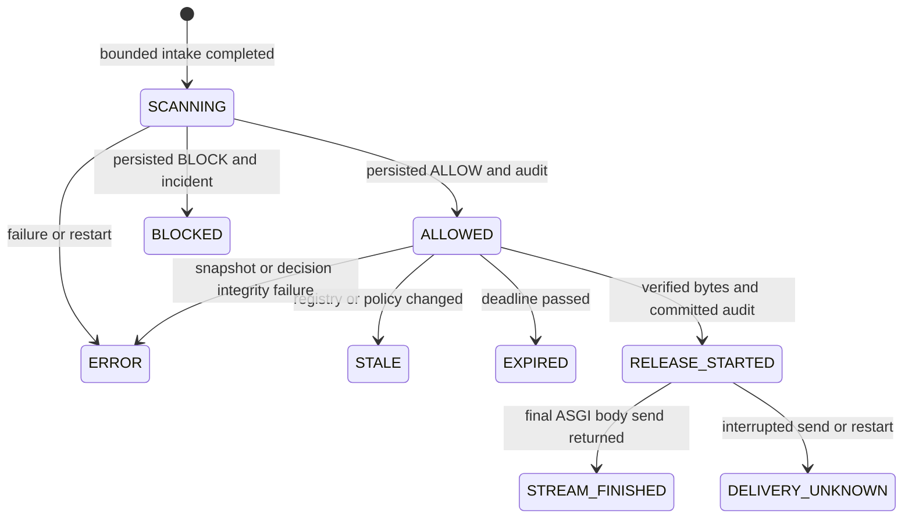

# Controlled transfer protocol, version 1

Phase 03 implements a local authenticated download gateway, not operating-system,
network, USB, clipboard or email interception. An application outside this gateway
can still transfer files. The staging agent (Phase 05, [staging-spec](staging-spec.md)) is a separate client of
this protocol and adds no new release path. The hosted demo ([deployment](deployment.md)) runs the same gateway.

## Integration and trust boundaries

`Gateway.submit` calls the existing `run_scan` with the same immutable `FrozenInput`
that was written into a private retained snapshot. It does not implement new matching
or policy rules. The Phase 01 profile, hashes, Merkle rules and APIs are unchanged.
`ScanView.release_authorized` remains false: a scan alone is never a release credential.
Only `POST /api/v1/transfers/{id}/release` produces transfer payload bytes.

The authenticated origin, operator-owned runtime, backend process and host OS are
trusted. Browser parameters, filenames, requests, uploaded bytes and old UI state
are untrusted. Registry and policy mutations serialize with release acquisition
through the existing singleton registry row. SQLite takes a writer lock using UPDATE;
PostgreSQL takes a row lock. Each unit of work uses a separate SQLAlchemy session.

## Snapshot and resource limits

Raw authenticated uploads pass through the existing streaming intake: actual received
bytes, not Content-Length, determine the upload cap (`ROOTSENTINEL_MAX_UPLOAD_BYTES`, default
10 MiB, 1 MiB on the hosted demo); inconsistent supplied lengths
and disconnects fail. Intake lasts at most 60 seconds. Payloads are never executed,
decompressed, decoded or treated as safe because of their extension.

The retained snapshot is a server UUID plus `.blob`, below the external private runtime
`retained` directory. No user filename becomes a path. Exclusive creation, fsync,
regular-file checks, single-link checks, reparse/symlink rejection and handle identity
comparison apply. POSIX uses O_NOFOLLOW, 0700 directories and 0600 files. Windows
reads DACLs and rejects grant entries beyond the current user, SYSTEM, administrators
and owner/creator-owner rights; it never changes system ACLs. Unknown ACE formats fail
closed. Parents must be operator-controlled. This is not a hostile-user filesystem
admission adapter. Host administrators and the application account can access plaintext.

Two shared processing slots cover intake, evaluation and verified response delivery.
A release retains its slot until send completion, disconnect, exception or a 60-second
send timeout. At most two delivery buffers of up to the upload cap exist per supported single worker;
Python/ASGI, hashing descriptors, intake copies and interpreter memory add overhead.
This is a bounded payload budget, **not a process-RSS guarantee**. The detector's
existing version/reference caps still apply. Pending transfers are limited to ten per
account and twenty globally (retained payload up to 20 times the upload cap). Creation and
release attempts share fixed one-minute windows: `ROOTSENTINEL_TRANSFER_RATE_PER_MINUTE` per
account (default 30, 10 on the hosted demo) and 120 globally. Restart resets rate buckets.
One API worker is required; multiplying workers invalidates the process resource budget.

## State machine

The HTTP intake stage has no persisted authorization. Once frozen bytes exist, the
first transaction stores SCANNING plus a submission audit event. The second transaction
stores scan/decision/evidence, incident if blocked, and mandatory audit events atomically.

Other transitions are rejected by `transition()`. Terminal states cannot become
ALLOWED. Incident resolution is independent of transfer state. No administrator
override exists. Even administrators cannot download another user's payload.

`Idempotency-Key` is a UUID unique per actor. Repeating the same key, filename, digest
and size returns the same transfer, including SCANNING or a terminal result. Changing
the input under that key returns 409. A new evaluation requires a new key. A unique
release-attempt constraint and serialized state transition enforce single use.

## Release invariant and linearization

1. Authenticate with the current opaque session, CSRF and permitted Origin.
2. Acquire a processing slot and the registry lock. Check ownership and revalidate
   session revocation/expiry and enabled user inside the transaction.
3. Verify the complete bounded HMAC stream and independent retained checkpoint.
4. Require ALLOWED, an unexpired retention window (`ROOTSENTINEL_RETENTION_SECONDS`, at most 900 seconds), persisted scan ALLOW, and exactly
   matching current registry revision and policy version.
5. Require the verified DECISION_ALLOWED audit event to bind actor, scan, policy,
   registry revision, digest, length and expiry to the transfer metadata.
6. Open the private generated snapshot safely and capture at most the upload cap into immutable
   bytes. Compare SHA-256 and length with both transfer metadata and scan manifest.
7. Persist RELEASE_STARTED, unique attempt and mandatory audit event; commit.
8. Remove retained snapshot content and retain an independently stored checkpoint
   of the committed audit head. Any failure before response construction releases no
   file-content bytes. Authorization is consumed even if checkpoint persistence fails.
9. Send chunks taken only from that same verified immutable byte object, never from
   a reopened path. Use a generated attachment filename, octet-stream, no-store and
   nosniff headers. Record completion or uncertainty afterward.

The authorization linearization point is the committed RELEASE_STARTED transition.
A policy/registry update cannot commit inside acquisition; changes committed afterward
do not recall bytes already authorized for this bounded response. No lock is held across
network delivery. Tests prove this ordering on both database fixture configurations.

A successful server send does not prove recipient receipt, browser storage or exactly-once
delivery. The custom response observes final ASGI send returning; it listens for disconnect
and send exceptions. Older ASGI servers may not expose disconnect promptly. If post-send
audit persistence fails, RELEASE_STARTED remains and restart recovery marks uncertainty.
A retry always needs a new transfer and current evaluation. See the
[ASGI HTTP specification](https://asgi.readthedocs.io/en/latest/specs/www.html) and
[Starlette response contract](https://starlette.dev/responses/).

## Retention and recovery

Blocked/failed content is removed promptly after durable decision recording. On startup,
when an audit key file and a checkpoint root are configured, bounded recovery marks SCANNING
as ERROR and RELEASE_STARTED as DELIVERY_UNKNOWN.
The same startup step runs one query for the earliest expiry among ALLOWED transfers and
keeps that time in memory; every later ALLOWED decision updates it.
The maintenance loop wakes every minute but makes a database call only when work is due.
When the in-memory time has passed, a bounded pass expires ALLOWED snapshots and reads the
next due time from what remains. When retained snapshot files exist, a pass deletes
terminal/orphan UUID snapshots; with nothing due it takes no registry lock and writes
nothing. With no due time and no snapshot file the loop does not touch the database, so
expiry still happens within a minute of the due time and an idle process stays silent. The
in-memory time can be earlier than needed (a released transfer leaves its time behind,
which costs one empty pass) but never later: it is changed only under the registry lock,
and a failed pass sets it to the present so the next wake-up retries. Release checks the
stored expiry itself and refuses an expired transfer whether or not maintenance has run.
Orphans must be older than 900 seconds; unrelated filenames are ignored.
An administrator may invoke `/transfers-maintenance/expire`, which always runs a full
pass. Each pass handles at most
100 records and examines at most 1,000 directory entries. Missing keys/audit storage
prevent mandatory transitions; release still fails closed. Operator repair and another
maintenance pass are required. Filesystem unlink is not secure erasure of physical media.

## Investigation and exports

Every protected-content BLOCK creates an OPEN incident referencing the actual scan.
Exact-match incidents are HIGH and threshold-only block incidents MEDIUM. These are
transparent triage categories, not proof of malicious intent. ADMIN/ANALYST may move
OPEN to INVESTIGATING or RESOLVED, and INVESTIGATING to RESOLVED. Resolution requires a
reason; revision preconditions prevent lost updates; RESOLVED is terminal. Up to 100
history entries are retained. Notes reject controls/markup and render as text. Do not
paste source content or secrets into notes; free text is not a secret-detection engine.

Authorized JSON exports contain allowlisted incident/scan metadata, matching evidence,
timestamps and audit references. They contain no payload bytes, session/password fields,
key material or paths. Export JSON itself is unsigned. Referenced HMAC records authenticate
their own canonical fields under retained-key trust, not the whole export. Notes are
linked by digest in update events. These are not independently certified forensic artifacts.

## Phase 04 contract

Build presentation against typed transfer/incident/audit responses and OpenAPI. Preserve
server-side ownership, CSRF, idempotency and state handling; never infer permission from
a disabled button or a cached ALLOW. Display STALE/EXPIRED/ERROR/DELIVERY_UNKNOWN distinctly.
There is one workspace in P0; multi-tenant/workspace isolation requires a later design.
